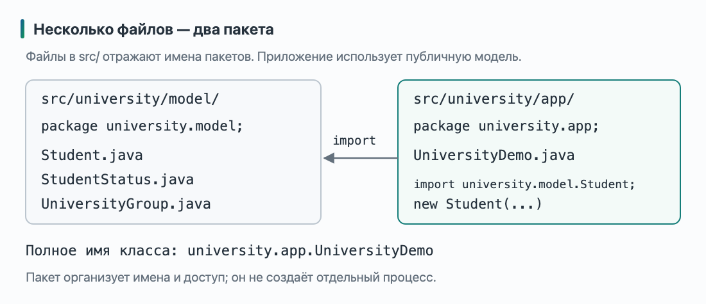
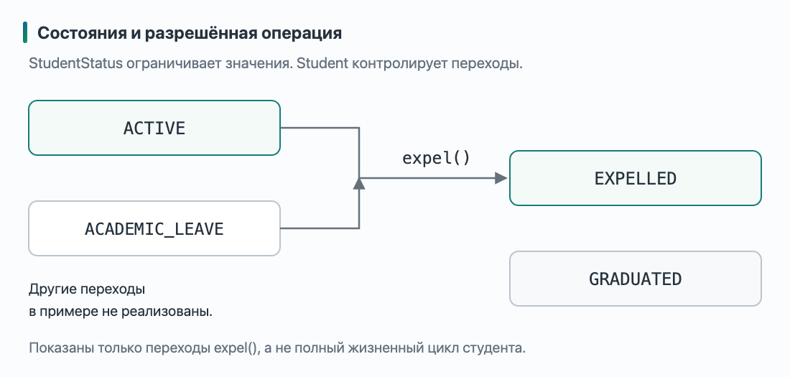
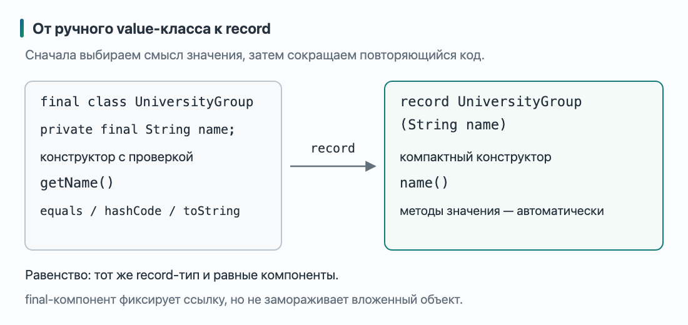
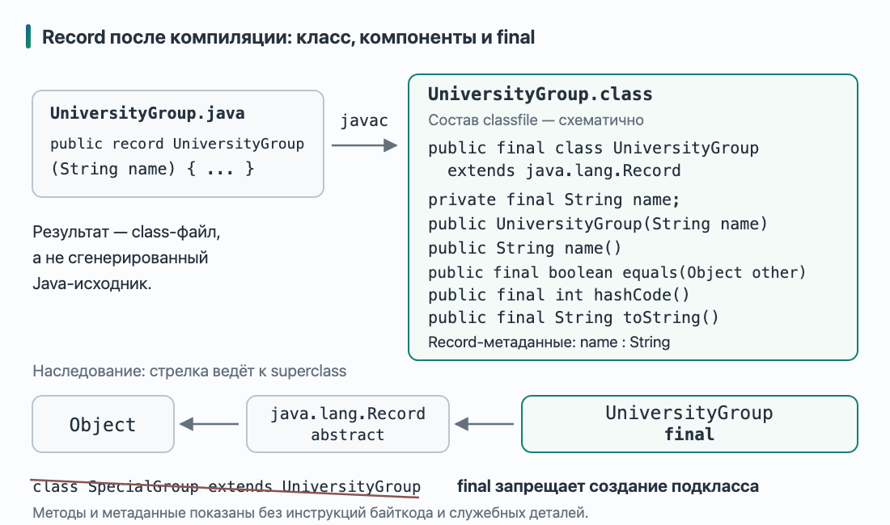

# Лекция 6. Организация Java-программы: пакеты, enum и record

[Главная](/)

От программы в одном файле — к модели из нескольких типов с понятными именами, состояниями и значениями.

### Содержание

1. [Когда модель перестаёт помещаться в один файл](#p1)
2. [Несколько файлов и пакеты](#p2)
3. [enum: конечный набор состояний](#p3)
4. [record: компактное представление значения](#p4)

[Вопросы для самопроверки](#review-questions) · [Дополнительное чтение](#reading)

<a id="p1"></a>

## 1. Когда модель перестаёт помещаться в один файл

В прошлых лекциях у нашей университетской системы появились студенты, группы и участники курса. Мы научились отделять публичный контракт от внутреннего устройства, использовать общий интерфейс и задавать осмысленное равенство групп. Но пока многие примеры помещались в один файл.

Сначала подготовим саму модель. Классов становится больше, поэтому разнесём их по файлам и пакетам. Вместо одного признака `expelled` появится тип состояния студента, а знакомую `UniversityGroup` запишем компактнее, сохранив смысл её значения.

В этой лекции используем Java 26 без preview-возможностей. Разберём организацию исходных файлов и две формы объявления типов: `enum` и `record`.

<a id="p2"></a>

## 2. Несколько файлов и пакеты

### Из общего файла — в отдельные объявления

В прошлой лекции в одном исходнике находились точка входа и несколько вспомогательных классов. Для демонстрации это удобно, но при развитии программы хочется открывать `Student.java`, а не искать студента среди всех объявлений.

У обычного небольшого проекта каждый публичный top-level тип размещают в отдельном файле с соответствующим именем. Например, `public class Student` — в `Student.java`. Само перемещение в другой файл не меняет объектную модель: `Student` всё ещё хранит ссылку на `UniversityGroup`, а приложение создаёт оба объекта.

Следующий вопрос — как сгруппировать файлы. Для этого в Java есть **пакеты** (*packages*): именованные группы связанных типов. Разделим учебный проект на два пакета:

- `university.model` — типы университетской модели;
- `university.app` — запускающий код, который пользуется моделью.

Точки в имени пакета позволяют организовать имена, но не создают особых прав доступа между `university` и `university.model`. Это разные пакеты. Код в подпакете не становится «внутренним кодом» родительского пакета только из-за похожего имени.



На схеме показана структура окончательного учебного проекта. Сначала проверим организацию на двух файлах, затем добавим студента и его статус. Каталог `src` выбран как корень исходников; он не является частью имени пакета.

### Минимальный проект из двух файлов

Создайте следующую структуру. В отличие от прежних примеров, код ниже надо сохранить **в два отдельных файла**:

```text
university-demo/
└── src/
    └── university/
        ├── model/
        │   └── UniversityGroup.java
        └── app/
            └── UniversityDemo.java
```

Пока `UniversityGroup` — обычный класс. Это **временная полная версия** `src/university/model/UniversityGroup.java`; в разделе про `record` мы заменим её:

```java
package university.model;

public final class UniversityGroup {
  private final String name;

  public UniversityGroup(String name) {
    if (name == null || name.isBlank()) {
      throw new IllegalArgumentException("Название группы не должно быть пустым");
    }
    this.name = name;
  }

  public String getName() {
    return name;
  }
}
```

Объявление `package university.model;` сообщает, какому пакету принадлежит тип. Полное имя класса теперь **`university.model.UniversityGroup`**. В обычной файловой организации исходников имени пакета соответствует путь `university/model` относительно корня `src`.

Второй файл — **полная временная версия** `src/university/app/UniversityDemo.java`:

```java
package university.app;

import university.model.UniversityGroup;

public class UniversityDemo {
  public static void main(String[] args) {
    UniversityGroup group = new UniversityGroup("24.Б11-мм");
    System.out.println(group.getName());
  }
}
```

`import` разрешает использовать короткое имя `UniversityGroup` вместо полного. Без этого импорта можно было бы написать:

```java
university.model.UniversityGroup group =
    new university.model.UniversityGroup("24.Б11-мм");
```

Оба варианта обращаются к одному типу. `import` не копирует класс, не создаёт объект и не устанавливает библиотеку: он участвует в разрешении имён в исходном коде. Пакетное объявление располагается перед импортами, импорты — перед объявлениями типов. Эти правила определены в [JLS 26, §7.3–7.5](https://docs.oracle.com/javase/specs/jls/se26/html/jls-7.html#jls-7.3).

### Где проходит граница доступа

Почему перед `UniversityGroup` появилось `public`? Теперь клиент находится в другом пакете. Если убрать `public` у класса, его имя не будет доступно из `university.app`, даже если конструктор и `getName()` останутся публичными.

Доступ без модификатора означает **доступ в пределах того же пакета**, а не того же файла. Два класса из `university.model`, размещённые в разных файлах, могут пользоваться такими объявлениями друг друга. Класс из `university.app` — уже нет. `import` не позволяет обойти это ограничение.

При этом `private`-поле `name` по-прежнему закрыто для клиента. Разделение по пакетам дополняет знакомую инкапсуляцию, а не заменяет её. Нормативные правила — [JLS 26, §7.6](https://docs.oracle.com/javase/specs/jls/se26/html/jls-7.html#jls-7.6) и [§6.6.1](https://docs.oracle.com/javase/specs/jls/se26/html/jls-6.html#jls-6.6.1).

Теперь программа организована по файлам и пакетам. Следующий шаг — точнее выразить допустимые данные внутри модели.

<a id="p3"></a>

## 3. `enum`: конечный набор состояний

В лекции про классы у студента было поле `boolean expelled`. Для вопроса «отчислен или нет?» этого хватало. Но теперь требуется различать студента, который учится, находится в академическом отпуске, отчислен или завершил обучение.

Можно добавить несколько логических полей. Но что означает объект, у которого одновременно `expelled == true` и `graduated == true`? Как проверять все сочетания? Другой вариант — строка `"ACTIVE"`, но тогда опечатка `"ACTVE"` имеет тот же подходящий тип `String`.

Если состояние должно быть одним из конечного набора именованных значений, для него подходит **`enum`**:

```java
package university.model;

public enum StudentStatus {
  ACTIVE,
  ACADEMIC_LEAVE,
  EXPELLED,
  GRADUATED
}
```

Это **полный файл** `src/university/model/StudentStatus.java`. `StudentStatus` — самостоятельный ссылочный тип, а имена внутри — его enum-константы. Например:

```java
StudentStatus status = StudentStatus.ACTIVE;
System.out.println(status == StudentStatus.EXPELLED);
```

Фрагмент для `main` напечатает `false`; если он находится в пакете приложения, ему нужен `import university.model.StudentStatus;`. Присвоить переменной строку `"ACTIVE"` или обратиться к несуществующей константе `StudentStatus.ACTVE` нельзя: ошибку обнаружит компилятор.

Для enum сравнение через `==` уместно: константа обозначает определённый экземпляр enum-класса. Оно также безопасно, если одна ссылка оказалась `null`. Это отличается от сравнения содержимого произвольных строк. Устройство enum-классов и констант определено в [JLS 26, §8.9](https://docs.oracle.com/javase/specs/jls/se26/html/jls-8.html#jls-8.9).

### Конечные значения и разрешённые переходы

Заменим поле студента. Следующий код — **сокращённый фрагмент внутри `Student`**, а не полное объявление класса:

```java
private StudentStatus status = StudentStatus.ACTIVE;

public StudentStatus getStatus() {
  return status;
}

public void expel() {
  if (status != StudentStatus.ACTIVE
      && status != StudentStatus.ACADEMIC_LEAVE) {
    throw new IllegalStateException("Студента в этом состоянии нельзя отчислить");
  }
  status = StudentStatus.EXPELLED;
}
```

Договорённость нашей новой модели: отчисление разрешено из `ACTIVE` и `ACADEMIC_LEAVE`. Попытка отчислить уже отчисленного студента или выпускника отклоняется. Это осознанное изменение по сравнению с первой учебной версией, где повторный `expel()` просто оставлял `true`.

`IllegalStateException` здесь сообщает, что текущее состояние объекта не допускает операцию. Подробно исключения мы изучим отдельно; сейчас важно, что проверка стоит до присваивания и ошибка не изменяет статус.



На схеме изображены только переходы операции `expel()`, а не полный жизненный цикл студента. Объявление enum даёт набор значений, но само не запрещает присваивание любого из них. Правила переходов обеспечивает объект `Student` через свои методы. В окончательной программе студент начинает в `ACTIVE`; остальные состояния обозначены для развития модели, а отдельных операций отпуска и выпуска мы здесь не реализуем.

### Выбор действия по значению

Для получения подписи подойдёт уже знакомое выражение `switch`. Это независимый фрагмент для `main`:

```java
StudentStatus status = StudentStatus.ACTIVE;
String label = switch (status) {
  case ACTIVE -> "Учится";
  case ACADEMIC_LEAVE -> "Академический отпуск";
  case EXPELLED -> "Отчислен";
  case GRADUATED -> "Завершил обучение";
};
System.out.println(label);
```

Вывод — `Учится`. Здесь перечислены все константы, поэтому `default` не требуется. Для рассматриваемого кода предполагаем существующее значение статуса, а не `null`.

Мы выразили набор состояний отдельным типом. Теперь вернёмся к другой части модели: неизменяемому значению группы.

<a id="p4"></a>

## 4. `record`: компактное представление значения

В четвёртой лекции мы определили: две университетские группы равны, когда совпадает их название. Затем вручную написали `equals`, согласованный `hashCode` и информативный `toString`. Этот путь был нужен, чтобы сначала выбрать смысл равенства и понять контракт.

Но если тип действительно представляет значение через небольшой набор компонентов, Java может предоставить часть такого кода автоматически. Для этого есть **record-классы**:

```java
package university.model;

public record UniversityGroup(String name) {
  public UniversityGroup {
    if (name == null || name.isBlank()) {
      throw new IllegalArgumentException("Название группы не должно быть пустым");
    }
  }
}
```

Это **новая полная версия** `src/university/model/UniversityGroup.java`. Она заменяет временный обычный класс из раздела 2; одновременно хранить обе версии с одинаковым полным именем нельзя.

`String name` в заголовке объявляет **компонент** record-класса. Для него автоматически предоставляются закрытое `final`-поле и публичный accessor `name()`. Доступ к значению выглядит так:

```java
UniversityGroup group = new UniversityGroup("24.Б11-мм");
System.out.println(group.name());
```

Обратите внимание на изменение API: раньше клиент вызывал `getName()`, теперь — `name()`. Поэтому в минимальном `UniversityDemo` из раздела 2 замените `group.getName()` на `group.name()`. Программа по-прежнему будет выводить название группы.

Record-класс также предоставляет канонический конструктор, `equals`, `hashCode` и `toString`, если соответствующие объявления не заданы явно. Он неявно `final`: объявить его подкласс нельзя. Record может реализовывать интерфейсы, но не может наследоваться от произвольно выбранного класса. Правила приведены в [JLS 26, §8.10](https://docs.oracle.com/javase/specs/jls/se26/html/jls-8.html#jls-8.10).



Схема показывает смысл предоставляемых объявлений, а не буквальную замену исходника компилятором. В частности, конкретную формулу вычисления hash code нам не требуется запоминать: нужен согласованный контракт, а не определённое число.

### Проверка данных в компактном конструкторе

Блок `public UniversityGroup { ... }` — **компактный канонический конструктор**. Его параметры выводятся из компонентов заголовка, поэтому мы не повторяем `String name` в скобках. В теле `name` обозначает входной параметр.

Если проверка проходит, поле автоматически получает значение параметра после нормального завершения тела. Поэтому здесь не надо писать `this.name = name`; присваивание полю-компоненту в теле компактного конструктора запрещено. Если имя не подходит, конструктор выбрасывает исключение, и клиент не получает успешно созданную группу. Эти правила задаёт [JLS 26, §8.10.4.2](https://docs.oracle.com/javase/specs/jls/se26/html/jls-8.html#jls-8.10.4.2).

### Во что превращается `record` после компиляции

Короткая запись `record` не означает, что в программе появляется объект принципиально другого рода. Компилятор создаёт class-файл, в котором описаны класс, его поля, конструктор и методы. Для нашей группы его структуру можно представить так:

```text
public final class UniversityGroup extends java.lang.Record {
  private final String name;

  public UniversityGroup(String name);
  public String name();
  public final boolean equals(Object other);
  public final int hashCode();
  public final String toString();
}
```

Это **сокращённое представление структуры class-файла**, а не Java-исходник для вставки в проект: тела методов и служебная информация опущены. Компилятор не обязан сначала создавать такой текстовый файл. В частности, предоставленные реализации `equals`, `hashCode` и `toString` не следует понимать как буквальное копирование вручную написанного шаблона.

В class-файле также сохраняется информация о record-компонентах: название `name` и его тип `String`. Поэтому record — не просто обычный класс, которому редактор автоматически дописал несколько методов: информация о его компонентах остаётся доступна и после компиляции.



В этой структуре важны две независимые детали:

- **`extends java.lang.Record`**: непосредственный superclass любого record-класса — `Record`, а его superclass — `Object`. Поэтому указать для record другой superclass нельзя; реализовывать интерфейсы по-прежнему можно.
- **`final class UniversityGroup`**: от самой группы наследоваться нельзя. `final` предоставляется языком автоматически, даже когда его нет в исходном заголовке `record`.

Следующий отдельный контрпример **намеренно не компилируется**:

```java
class SpecialGroup extends UniversityGroup {
  SpecialGroup(String name) {
    super(name);
  }
}
```

Причина отказа — попытка наследования от `final`-класса, а не отсутствие подходящего конструктора. Компоненты заголовка фиксируют состав представляемого значения; запрет наследования не позволяет подклассу незаметно расширить его новым состоянием. Это согласуется со знакомой проблемой равенства в открытых иерархиях из лекции 4.

При этом `Record` сам является абстрактным классом, а не `final`-классом: именно от него наследуются record-классы. Но вручную объявить обычный класс через `class X extends Record` Java не разрешает — эту связь задаёт объявление `record`. Нормативные правила приведены в [JLS 26, §8.10](https://docs.oracle.com/javase/specs/jls/se26/html/jls-8.html#jls-8.10), назначение общей основы — в [API `java.lang.Record`](https://docs.oracle.com/en/java/javase/26/docs/api/java.base/java/lang/Record.html).

### Равенство остаётся решением модели

Для нашего единственного строкового компонента результаты знакомы. Независимый фрагмент для `main`:

```java
UniversityGroup first = new UniversityGroup("24.Б11-мм");
UniversityGroup second = new UniversityGroup("24.Б11-мм");

System.out.println(first == second);
System.out.println(first.equals(second));
System.out.println(first.hashCode() == second.hashCode());
System.out.println(first);
```

Вывод:

```text
false
true
true
UniversityGroup[name=24.Б11-мм]
```

Два `new` создали разные объекты. Предоставленный `equals` сравнивает компоненты record-объектов одного record-класса, а `hashCode` согласован с этим равенством. Для ссылочного компонента `String` используется его логическое равенство, поэтому значения с одинаковым текстом равны.

Однако добавление нового компонента может изменить смысл равенства. Если в заголовок включить ещё и число участников группы, оно тоже будет учитываться предоставленными методами. Значит, record выбирают после ответа на вопрос «что представляет значение?», а не только ради сокращения строк.

### `final`-компоненты не дают глубокой неизменяемости

Название группы — неизменяемая строка, поэтому наша `UniversityGroup` удобна как стабильное значение. Но record не делает любой достижимый объект неизменяемым. Следующий **независимый пример внутри `main`** использует локальное объявление record только для демонстрации:

```java
record Grades(int[] values) {}

int[] source = {4, 5};
Grades grades = new Grades(source);
source[0] = 2;
System.out.println(grades.values()[0]);

grades.values()[1] = 3;
System.out.println(source[1]);
```

Результат — `2`, затем `3`. Компонент нельзя переназначить, но он хранит ссылку на изменяемый массив. И конструктор, и accessor здесь передают ту же ссылку; автоматической защитной копии нет. Чтобы изолировать представление, копию пришлось бы делать и на входе, и при выдаче массива. При таком проектировании отдельно проверяют и контракт равенства: массивы по умолчанию не сравнивают содержимое через `equals`.

Поэтому изменяемый `Student` с операцией `expel()` оставим обычным классом. `UniversityGroup` в нашей модели представляет значение, а `Student` — объект с изменяющимся состоянием и разрешёнными действиями. Разные задачи требуют разных форм объявления.

Теперь у модели есть имена, границы пакетов и подходящие типы данных. Эти решения позволяют развивать программу, сохраняя понятные контракты её частей.

<a id="review-questions"></a>

## Вопросы для самопроверки

1. Чем имя файла `Student.java` отличается от полного имени `university.model.Student`? Что меняет `import`, а чего он не разрешает?
2. Почему `public` у метода недостаточно для обращения к нему из другого пакета, если сам top-level класс недоступен?
3. Какие ошибки со статусом предотвращает `StudentStatus`, а какие правила должен по-прежнему проверять `Student`?
4. Почему у `UniversityGroup` accessor называется `name()`? Какой superclass у record-класса и почему нельзя создать его подкласс?
5. На основании чего record сравнивает две группы? Что изменится, если добавить новый компонент?
6. Можно ли изменить массив, сохранённый в компоненте record? Делает ли `final` такую запись глубоко неизменяемой?
7. Почему изменяемый `Student` оставили обычным классом, а `UniversityGroup` представили как record?

<a id="reading"></a>

## Дополнительное чтение

- [JLS 26, Packages and Modules, §7.3–7.6](https://docs.oracle.com/javase/specs/jls/se26/html/jls-7.html#jls-7.3) — объявления пакетов, импорты и top-level типы.
- [JLS 26, Enum Classes](https://docs.oracle.com/javase/specs/jls/se26/html/jls-8.html#jls-8.9) — правила объявления enum-классов.
- [JLS 26, Record Classes](https://docs.oracle.com/javase/specs/jls/se26/html/jls-8.html#jls-8.10) — компоненты, конструкторы и предоставляемые методы.
- [Java 26: Record Classes](https://docs.oracle.com/en/java/javase/26/language/records.html) — короткое введение в record-классы.
