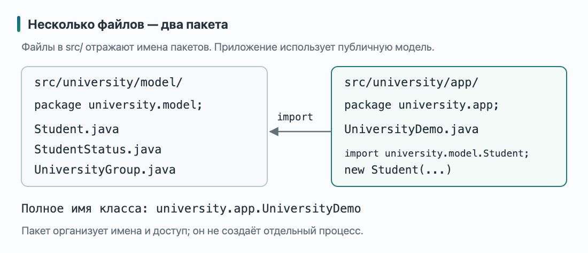
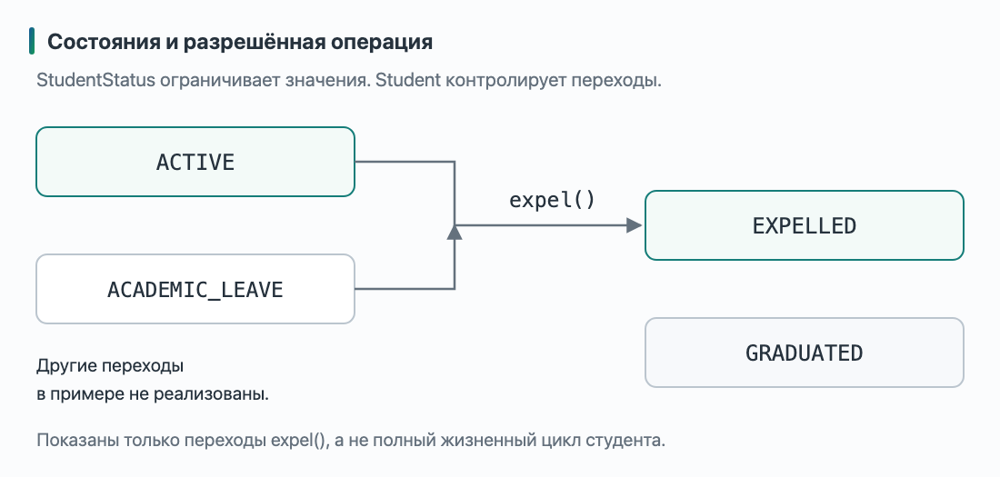
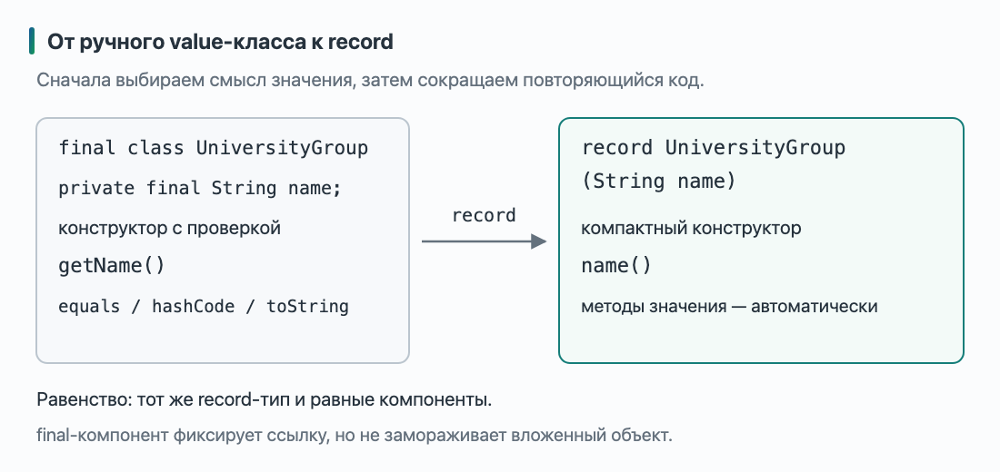
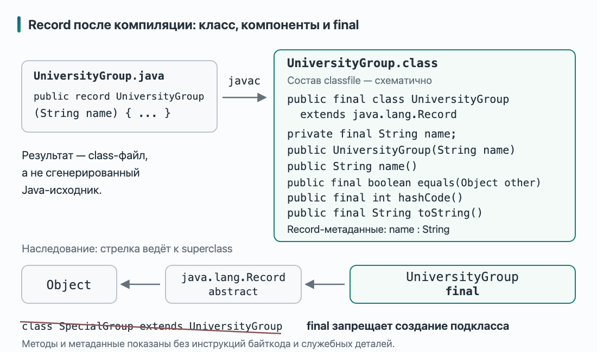
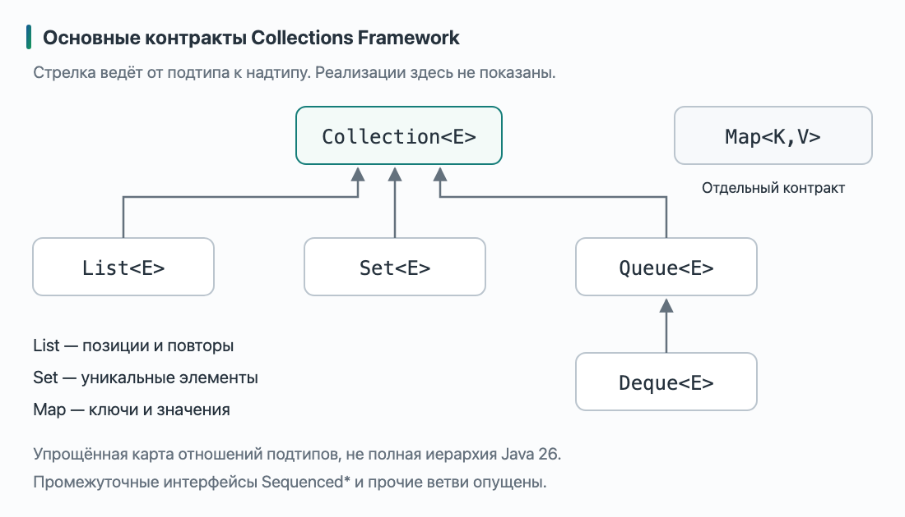
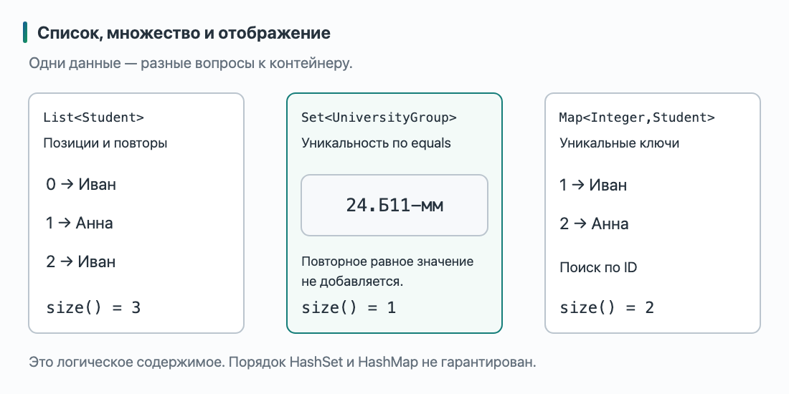
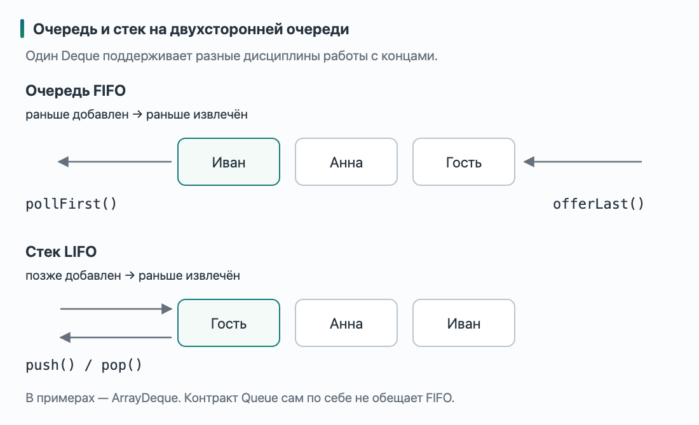
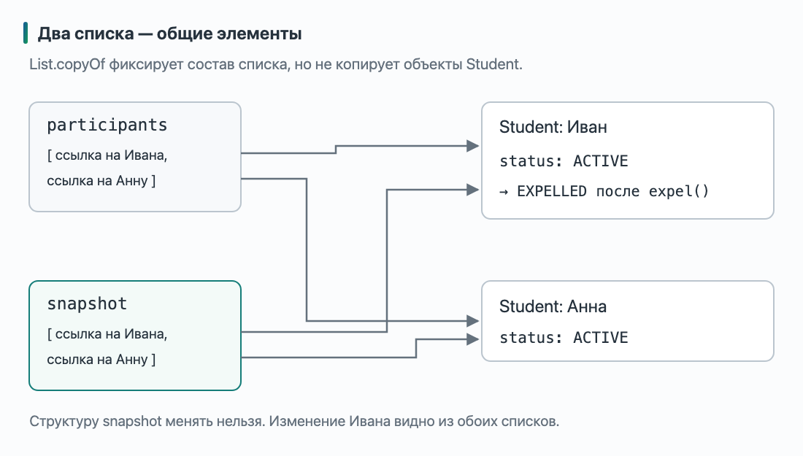

# Лекция 6. Организация Java-программы, типы данных и Collections Framework

[Главная](/)

От нескольких файлов и подходящих типов данных — к выбору коллекции по задаче: список, множество, отображение или очередь.

### Содержание

1. [Когда модель перестаёт помещаться в один файл](#p1)
2. [Несколько файлов и пакеты](#p2)
3. [enum: конечный набор состояний](#p3)
4. [record: компактное представление значения](#p4)
5. [От массива к Collections Framework](#p5)
6. [List: позиции, порядок и повторы](#p6)
7. [Set: одно логическое значение вместо повторов](#p7)
8. [Map: найти значение по ключу](#p8)
9. [Queue и Deque: порядок обработки](#p9)
10. [Что именно разрешено менять](#p10)
11. [Собираем университетскую программу](#p11)
12. [Выбираем коллекцию по вопросу задачи](#p12)

[Дополнительное чтение](#reading) · [Краткий справочник](#syntax-reference)

<a id="p1"></a>

## 1. Когда модель перестаёт помещаться в один файл

В прошлых лекциях у нашей университетской системы появились студенты, группы и участники курса. Мы научились отделять публичный контракт от внутреннего устройства, использовать общий интерфейс и задавать осмысленное равенство групп. Но пока многие примеры помещались в один файл, а набор участников был небольшим массивом.

Теперь система должна решать четыре задачи:

- хранить список записей на занятие, где один студент может встретиться несколько раз;
- собирать уникальные университетские группы участников;
- находить студента по идентификатору;
- обрабатывать заявки в порядке поступления.

Данные могут относиться к одним и тем же объектам, но требования к хранению различаются. В списке важны позиции и повторы, для групп — отсутствие дубликатов, при поиске — связь идентификатора со студентом, для заявок — порядок обработки. Позже мы выберем для этих задач разные коллекции стандартной библиотеки.

Сначала подготовим саму модель. Классов становится больше, поэтому разнесём их по файлам и пакетам. Вместо одного признака `expelled` появится тип состояния студента, а знакомую `UniversityGroup` запишем компактнее, сохранив смысл её значения.

В этой лекции используем Java 26 без preview-возможностей. Разбираем внешний контракт коллекций и базовые операции. Их внутреннее устройство и стоимость операций станут темой следующего занятия. Механизм обхода, сравнение, сортировка и проектирование API коллекций тоже получат отдельное объяснение.

<a id="p2"></a>

## 2. Несколько файлов и пакеты

### Из общего файла — в отдельные объявления

В прошлой лекции в одном исходнике находились точка входа и несколько вспомогательных классов. Для демонстрации это удобно, но при развитии программы хочется открывать `Student.java`, а не искать студента среди всех объявлений.

У обычного небольшого проекта каждый публичный top-level тип размещают в отдельном файле с соответствующим именем. Например, `public class Student` — в `Student.java`. Само перемещение в другой файл не меняет объектную модель: `Student` всё ещё хранит ссылку на `UniversityGroup`, а приложение создаёт оба объекта.

Следующий вопрос — как сгруппировать файлы. Для этого в Java есть **пакеты** (*packages*): именованные группы связанных типов. Разделим учебный проект на два пакета:

- `university.model` — типы университетской модели;
- `university.app` — запускающий код, который пользуется моделью.

Точки в имени пакета позволяют организовать имена, но не создают особых прав доступа между `university` и `university.model`. Это разные пакеты. Код в подпакете не становится «внутренним кодом» родительского пакета только из-за похожего имени.



На схеме показана структура окончательного учебного проекта. Сначала проверим организацию на двух файлах, затем добавим студента и его статус. Каталог `src` выбран как корень исходников; он не является частью имени пакета.

### Минимальный проект из двух файлов

Создайте следующую структуру. В отличие от прежних примеров, код ниже надо сохранить **в два отдельных файла**:

```text
university-demo/
└── src/
    └── university/
        ├── model/
        │   └── UniversityGroup.java
        └── app/
            └── UniversityDemo.java
```

Пока `UniversityGroup` — обычный класс. Это **временная полная версия** `src/university/model/UniversityGroup.java`; в разделе про `record` мы заменим её:

```java
package university.model;

public final class UniversityGroup {
  private final String name;

  public UniversityGroup(String name) {
    if (name == null || name.isBlank()) {
      throw new IllegalArgumentException("Название группы не должно быть пустым");
    }
    this.name = name;
  }

  public String getName() {
    return name;
  }
}
```

Объявление `package university.model;` сообщает, какому пакету принадлежит тип. Полное имя класса теперь **`university.model.UniversityGroup`**. В обычной файловой организации исходников имени пакета соответствует путь `university/model` относительно корня `src`.

Второй файл — **полная временная версия** `src/university/app/UniversityDemo.java`:

```java
package university.app;

import university.model.UniversityGroup;

public class UniversityDemo {
  public static void main(String[] args) {
    UniversityGroup group = new UniversityGroup("24.Б11-мм");
    System.out.println(group.getName());
  }
}
```

`import` разрешает использовать короткое имя `UniversityGroup` вместо полного. Без этого импорта можно было бы написать:

```java
university.model.UniversityGroup group =
    new university.model.UniversityGroup("24.Б11-мм");
```

Оба варианта обращаются к одному типу. `import` не копирует класс, не создаёт объект и не устанавливает библиотеку: он участвует в разрешении имён в исходном коде. Пакетное объявление располагается перед импортами, импорты — перед объявлениями типов. Эти правила определены в [JLS 26, §7.3–7.5](https://docs.oracle.com/javase/specs/jls/se26/html/jls-7.html#jls-7.3).

### Где проходит граница доступа

Почему перед `UniversityGroup` появилось `public`? Теперь клиент находится в другом пакете. Если убрать `public` у класса, его имя не будет доступно из `university.app`, даже если конструктор и `getName()` останутся публичными.

Доступ без модификатора означает **доступ в пределах того же пакета**, а не того же файла. Два класса из `university.model`, размещённые в разных файлах, могут пользоваться такими объявлениями друг друга. Класс из `university.app` — уже нет. `import` не позволяет обойти это ограничение.

При этом `private`-поле `name` по-прежнему закрыто для клиента. Разделение по пакетам дополняет знакомую инкапсуляцию, а не заменяет её. Нормативные правила — [JLS 26, §7.6](https://docs.oracle.com/javase/specs/jls/se26/html/jls-7.html#jls-7.6) и [§6.6.1](https://docs.oracle.com/javase/specs/jls/se26/html/jls-6.html#jls-6.6.1).

Теперь программа организована по файлам и пакетам. Следующий шаг — точнее выразить допустимые данные внутри модели.

<a id="p3"></a>

## 3. `enum`: конечный набор состояний

В лекции про классы у студента было поле `boolean expelled`. Для вопроса «отчислен или нет?» этого хватало. Но теперь требуется различать студента, который учится, находится в академическом отпуске, отчислен или завершил обучение.

Можно добавить несколько логических полей. Но что означает объект, у которого одновременно `expelled == true` и `graduated == true`? Как проверять все сочетания? Другой вариант — строка `"ACTIVE"`, но тогда опечатка `"ACTVE"` имеет тот же подходящий тип `String`.

Если состояние должно быть одним из конечного набора именованных значений, для него подходит **`enum`**:

```java
package university.model;

public enum StudentStatus {
  ACTIVE,
  ACADEMIC_LEAVE,
  EXPELLED,
  GRADUATED
}
```

Это **полный файл** `src/university/model/StudentStatus.java`. `StudentStatus` — самостоятельный ссылочный тип, а имена внутри — его enum-константы. Например:

```java
StudentStatus status = StudentStatus.ACTIVE;
System.out.println(status == StudentStatus.EXPELLED);
```

Фрагмент для `main` напечатает `false`; если он находится в пакете приложения, ему нужен `import university.model.StudentStatus;`. Присвоить переменной строку `"ACTIVE"` или обратиться к несуществующей константе `StudentStatus.ACTVE` нельзя: ошибку обнаружит компилятор.

Для enum сравнение через `==` уместно: константа обозначает определённый экземпляр enum-класса. Оно также безопасно, если одна ссылка оказалась `null`. Это отличается от сравнения содержимого произвольных строк. Устройство enum-классов и констант определено в [JLS 26, §8.9](https://docs.oracle.com/javase/specs/jls/se26/html/jls-8.html#jls-8.9).

### Конечные значения и разрешённые переходы

Заменим поле студента. Следующий код — **сокращённый фрагмент внутри `Student`**, а не полное объявление класса:

```java
private StudentStatus status = StudentStatus.ACTIVE;

public StudentStatus getStatus() {
  return status;
}

public void expel() {
  if (status != StudentStatus.ACTIVE
      && status != StudentStatus.ACADEMIC_LEAVE) {
    throw new IllegalStateException("Студента в этом состоянии нельзя отчислить");
  }
  status = StudentStatus.EXPELLED;
}
```

Договорённость нашей новой модели: отчисление разрешено из `ACTIVE` и `ACADEMIC_LEAVE`. Попытка отчислить уже отчисленного студента или выпускника отклоняется. Это осознанное изменение по сравнению с первой учебной версией, где повторный `expel()` просто оставлял `true`.

`IllegalStateException` здесь сообщает, что текущее состояние объекта не допускает операцию. Подробно исключения мы изучим отдельно; сейчас важно, что проверка стоит до присваивания и ошибка не изменяет статус.



На схеме изображены только переходы операции `expel()`, а не полный жизненный цикл студента. Объявление enum даёт набор значений, но само не запрещает присваивание любого из них. Правила переходов обеспечивает объект `Student` через свои методы. В окончательной программе студент начинает в `ACTIVE`; остальные состояния обозначены для развития модели, а отдельных операций отпуска и выпуска мы здесь не реализуем.

### Выбор действия по значению

Для получения подписи подойдёт уже знакомое выражение `switch`. Это независимый фрагмент для `main`:

```java
StudentStatus status = StudentStatus.ACTIVE;
String label = switch (status) {
  case ACTIVE -> "Учится";
  case ACADEMIC_LEAVE -> "Академический отпуск";
  case EXPELLED -> "Отчислен";
  case GRADUATED -> "Завершил обучение";
};
System.out.println(label);
```

Вывод — `Учится`. Здесь перечислены все константы, поэтому `default` не требуется. Для рассматриваемого кода предполагаем существующее значение статуса, а не `null`.

Мы выразили набор состояний отдельным типом. Теперь вернёмся к другой части модели: неизменяемому значению группы.

<a id="p4"></a>

## 4. `record`: компактное представление значения

В четвёртой лекции мы определили: две университетские группы равны, когда совпадает их название. Затем вручную написали `equals`, согласованный `hashCode` и информативный `toString`. Этот путь был нужен, чтобы сначала выбрать смысл равенства и понять контракт.

Но если тип действительно представляет значение через небольшой набор компонентов, Java может предоставить часть такого кода автоматически. Для этого есть **record-классы**:

```java
package university.model;

public record UniversityGroup(String name) {
  public UniversityGroup {
    if (name == null || name.isBlank()) {
      throw new IllegalArgumentException("Название группы не должно быть пустым");
    }
  }
}
```

Это **новая полная версия** `src/university/model/UniversityGroup.java`. Она заменяет временный обычный класс из раздела 2; одновременно хранить обе версии с одинаковым полным именем нельзя.

`String name` в заголовке объявляет **компонент** record-класса. Для него автоматически предоставляются закрытое `final`-поле и публичный accessor `name()`. Доступ к значению выглядит так:

```java
UniversityGroup group = new UniversityGroup("24.Б11-мм");
System.out.println(group.name());
```

Обратите внимание на изменение API: раньше клиент вызывал `getName()`, теперь — `name()`. Поэтому в минимальном `UniversityDemo` из раздела 2 замените `group.getName()` на `group.name()`. Программа по-прежнему будет выводить название группы.

Record-класс также предоставляет канонический конструктор, `equals`, `hashCode` и `toString`, если соответствующие объявления не заданы явно. Он неявно `final`: объявить его подкласс нельзя. Record может реализовывать интерфейсы, но не может наследоваться от произвольно выбранного класса. Правила приведены в [JLS 26, §8.10](https://docs.oracle.com/javase/specs/jls/se26/html/jls-8.html#jls-8.10).



Схема показывает смысл предоставляемых объявлений, а не буквальную замену исходника компилятором. В частности, конкретную формулу вычисления hash code нам не требуется запоминать: нужен согласованный контракт, а не определённое число.

### Проверка данных в компактном конструкторе

Блок `public UniversityGroup { ... }` — **компактный канонический конструктор**. Его параметры выводятся из компонентов заголовка, поэтому мы не повторяем `String name` в скобках. В теле `name` обозначает входной параметр.

Если проверка проходит, поле автоматически получает значение параметра после нормального завершения тела. Поэтому здесь не надо писать `this.name = name`; присваивание полю-компоненту в теле компактного конструктора запрещено. Если имя не подходит, конструктор выбрасывает исключение, и клиент не получает успешно созданную группу. Эти правила задаёт [JLS 26, §8.10.4.2](https://docs.oracle.com/javase/specs/jls/se26/html/jls-8.html#jls-8.10.4.2).

### Во что превращается `record` после компиляции

Короткая запись `record` не означает, что в программе появляется объект принципиально другого рода. Компилятор создаёт class-файл, в котором описаны класс, его поля, конструктор и методы. Для нашей группы его структуру можно представить так:

```text
public final class UniversityGroup extends java.lang.Record {
  private final String name;

  public UniversityGroup(String name);
  public String name();
  public final boolean equals(Object other);
  public final int hashCode();
  public final String toString();
}
```

Это **сокращённое представление структуры class-файла**, а не Java-исходник для вставки в проект: тела методов и служебная информация опущены. Компилятор не обязан сначала создавать такой текстовый файл. В частности, предоставленные реализации `equals`, `hashCode` и `toString` не следует понимать как буквальное копирование вручную написанного шаблона.

В class-файле также сохраняется информация о record-компонентах: название `name` и его тип `String`. Поэтому record — не просто обычный класс, которому редактор автоматически дописал несколько методов: информация о его компонентах остаётся доступна и после компиляции.



В этой структуре важны две независимые детали:

- **`extends java.lang.Record`**: непосредственный superclass любого record-класса — `Record`, а его superclass — `Object`. Поэтому указать для record другой superclass нельзя; реализовывать интерфейсы по-прежнему можно.
- **`final class UniversityGroup`**: от самой группы наследоваться нельзя. `final` предоставляется языком автоматически, даже когда его нет в исходном заголовке `record`.

Следующий отдельный контрпример **намеренно не компилируется**:

```java
class SpecialGroup extends UniversityGroup {
  SpecialGroup(String name) {
    super(name);
  }
}
```

Причина отказа — попытка наследования от `final`-класса, а не отсутствие подходящего конструктора. Компоненты заголовка фиксируют состав представляемого значения; запрет наследования не позволяет подклассу незаметно расширить его новым состоянием. Это согласуется со знакомой проблемой равенства в открытых иерархиях из лекции 4.

При этом `Record` сам является абстрактным классом, а не `final`-классом: именно от него наследуются record-классы. Но вручную объявить обычный класс через `class X extends Record` Java не разрешает — эту связь задаёт объявление `record`. Нормативные правила приведены в [JLS 26, §8.10](https://docs.oracle.com/javase/specs/jls/se26/html/jls-8.html#jls-8.10), назначение общей основы — в [API `java.lang.Record`](https://docs.oracle.com/en/java/javase/26/docs/api/java.base/java/lang/Record.html).

### Равенство остаётся решением модели

Для нашего единственного строкового компонента результаты знакомы. Независимый фрагмент для `main`:

```java
UniversityGroup first = new UniversityGroup("24.Б11-мм");
UniversityGroup second = new UniversityGroup("24.Б11-мм");

System.out.println(first == second);
System.out.println(first.equals(second));
System.out.println(first.hashCode() == second.hashCode());
System.out.println(first);
```

Вывод:

```text
false
true
true
UniversityGroup[name=24.Б11-мм]
```

Два `new` создали разные объекты. Предоставленный `equals` сравнивает компоненты record-объектов одного record-класса, а `hashCode` согласован с этим равенством. Для ссылочного компонента `String` используется его логическое равенство, поэтому значения с одинаковым текстом равны.

Однако добавление нового компонента может изменить смысл равенства. Если в заголовок включить ещё и число участников группы, оно тоже будет учитываться предоставленными методами. Значит, record выбирают после ответа на вопрос «что представляет значение?», а не только ради сокращения строк.

### `final`-компоненты не дают глубокой неизменяемости

Название группы — неизменяемая строка, поэтому наша `UniversityGroup` удобна как стабильное значение. Но record не делает любой достижимый объект неизменяемым. Следующий **независимый пример внутри `main`** использует локальное объявление record только для демонстрации:

```java
record Grades(int[] values) {}

int[] source = {4, 5};
Grades grades = new Grades(source);
source[0] = 2;
System.out.println(grades.values()[0]);

grades.values()[1] = 3;
System.out.println(source[1]);
```

Результат — `2`, затем `3`. Компонент нельзя переназначить, но он хранит ссылку на изменяемый массив. И конструктор, и accessor здесь передают ту же ссылку; автоматической защитной копии нет. Чтобы изолировать представление, копию пришлось бы делать и на входе, и при выдаче массива. При таком проектировании отдельно проверяют и контракт равенства: массивы по умолчанию не сравнивают содержимое через `equals`.

Поэтому изменяемый `Student` с операцией `expel()` оставим обычным классом. `UniversityGroup` в нашей модели представляет значение, а `Student` — объект с изменяющимся состоянием и разрешёнными действиями. Разные задачи требуют разных форм объявления.

Теперь у модели есть имена, границы пакетов и подходящие типы данных. Можно перейти к её наборам: как хранить несколько студентов, исключать повторяющиеся группы, искать по идентификатору и организовать очередь?

<a id="p5"></a>

## 5. От массива к Collections Framework

Мы научились описывать одного студента и одну группу. Теперь курс должен хранить всех участников. Массив позволяет начать:

```java
Student[] participants = {ivan, anna};
```

Но что делать, если записался ещё один студент? Длина этого массива уже зафиксирована. Можно создать другой массив, скопировать ссылки и добавить новую. А если нужно удалить участника, запретить повторную запись или искать студента по идентификатору? Для каждой задачи пришлось бы самостоятельно выбрать правила хранения и написать операции.

В стандартной библиотеке Java уже есть согласованный набор таких инструментов — **Java Collections Framework**. Слово framework здесь означает общую систему контрактов, реализаций и операций для работы с группами данных. Это часть платформы, для неё не нужно устанавливать дополнительную библиотеку. Основные знакомые нам типы находятся в пакете `java.util`.

### Контракт и реализация

Вспомним `CourseParticipant`: клиент знал доступные операции, а конкретный класс реализовывал их. У коллекций действует та же идея. `List` описывает список, а `ArrayList` — одну из его реализаций:

```java
List<Student> participants = new ArrayList<>();
```

Чтобы использовать эти короткие имена в отдельном файле, добавьте после `package` и перед объявлением класса:

```java
import java.util.ArrayList;
import java.util.List;
```

Слева указан интерфейсный тип переменной, справа создаётся конкретный объект. Это уже знакомый полиморфизм, а не специальное правило коллекций. Здесь достаточно уметь читать такую запись; проектирование методов, принимающих коллекции разных типов, обсудим отдельно.

`<Student>` задаёт тип элементов. Компилятор разрешает добавлять студентов и возвращает `Student` при чтении элемента. Запись `<>` справа называется **diamond**: в этом выражении компилятор выводит аргумент типа из контекста. Она не означает «коллекция без типа».

Примитивный тип нельзя поставить на место аргумента generic-типа. Для списка идентификаторов нужна обёртка `Integer`:

```java
List<Integer> studentIds = new ArrayList<>();
studentIds.add(1);
int firstId = studentIds.get(0);
```

Здесь при добавлении выполняется boxing, при присваивании результата в `int` — unboxing. Для отображения позже понадобятся уже два аргумента типа: один для ключа, другой для значения. Правила generic-типов остаются теми же, что в предыдущей лекции; [ограничение на примитивные аргументы типа](https://docs.oracle.com/javase/tutorial/java/generics/restrictions.html) не исчезает при использовании коллекций.

### Три похожих названия

Легко перепутать названия, отличающиеся одной буквой:

| Название | Что оно обозначает |
| --- | --- |
| **Collections Framework** | Всю систему интерфейсов, реализаций и библиотечных операций |
| **`Collection<E>`** | Общий интерфейс коллекций отдельных элементов |
| **`Collections`** | Служебный класс со статическими методами работы с коллекциями |

Например, `Collection` — надтип для списков, множеств и очередей. В нём объявлены общие операции вроде `size()`, `isEmpty()` и `contains(...)`. `Collections` не является контейнером: объект этого класса не создают для хранения студентов. Его статические методы выполняют общие операции; они пригодятся по мере знакомства с библиотекой. См. [API `Collection`](https://docs.oracle.com/en/java/javase/26/docs/api/java.base/java/util/Collection.html) и [API `Collections`](https://docs.oracle.com/en/java/javase/26/docs/api/java.base/java/util/Collections.html).

### Карта основных контрактов

Разным задачам нужны разные обещания контейнера:

- список `List` сохраняет последовательность элементов и позволяет обращаться по позиции;
- множество `Set` не содержит логических дубликатов;
- очередь `Queue` предоставляет операции добавления и извлечения для обработки элементов;
- двухсторонняя очередь `Deque` позволяет работать с обоими концами;
- отображение `Map` связывает ключи со значениями.



Это карта основных семейств, а не полная схема непосредственного `extends`. В Java 26 есть также `SequencedCollection`, `SequencedSet` и `SequencedMap` для контрактов с определённым порядком элементов или записей; промежуточные интерфейсы на рисунке опущены. `Map` относится к Collections Framework, но **не является подтипом `Collection`**. Актуальный состав библиотеки приведён в [документации `java.util`](https://docs.oracle.com/en/java/javase/26/docs/api/java.base/java/util/package-summary.html).

Теперь рассмотрим каждый контракт через задачу университетской системы. Устройство хранения пока оставим закрытым: сначала научимся понимать обещания контейнера и наблюдать результат операций.

Для следующих примеров подготовим одни и те же исходные объекты. Это **начало `main`**; нужны imports `university.model.Student` и `university.model.UniversityGroup`. Полный класс `Student` приведён в разделе 11, его конструктор получает ID, имя и группу:

```java
UniversityGroup group = new UniversityGroup("24.Б11-мм");
Student ivan = new Student(1, "Иван Петров", group);
Student anna = new Student(
    2, "Анна Смирнова", new UniversityGroup("24.Б11-мм")
);
```

Дальнейшие разделы показывают независимые сценарии над этими объектами. Если фрагмент явно продолжает предыдущий, это отмечено в тексте; иначе контейнер создаётся заново.


<a id="p6"></a>

## 6. `List`: позиции, порядок и повторы

Список участников открытого занятия должен помнить последовательность записей. Для начала разрешим повторы: один и тот же студент может оказаться записан дважды, и мы хотим заметить это отдельно, а не автоматически убрать запись.

Следующие фрагменты — **код внутри `main`**, а не отдельные классы. Они используют `ivan` и `anna`: двух студентов, созданных для общего примера. Полные определения модели и программы будут в разделе 11. Для первого фрагмента нужны импорты `java.util.List` и `java.util.ArrayList`.

```java
List<Student> participants = new ArrayList<>();
participants.add(ivan);
participants.add(anna);
participants.add(ivan);

System.out.println(participants.size());
System.out.println(participants.get(0).getName());
System.out.println(participants.get(2) == ivan);
```

Вывод:

```text
3
Иван Петров
true
```

В списке три позиции. В первой и третьей записаны ссылки на один объект Ивана; `add` не скопировал студента. Как и у массива, индексы начинаются с нуля. В отличие от массива, число элементов меняется при добавлении и удалении. Вместо поля `length` используется метод `size()`.

Порядок списка — последовательность, которую мы сформировали операциями, а не автоматическое расположение по алфавиту. Перестановка Ивана и Анны меняет список, даже если состав участников остаётся тем же.

Продолжим работу с **тем же списком**:

```java
Student previous = participants.set(1, ivan);
System.out.println(previous.getName());
System.out.println(participants.size());

Student removed = participants.remove(0);
System.out.println(removed.getName());
System.out.println(participants.size());
```

Получим `Анна Смирнова`, `3`, `Иван Петров`, `2`. Метод `set` заменил ссылку в существующей позиции и вернул прежний элемент: размер не изменился. `remove(0)` удалил позицию с индексом 0, вернул удалённый элемент, а следующие позиции получили новые индексы.

Для вставки перед существующей позицией есть `add(index, element)`. Для проверки наличия — `contains(element)`, для отсутствия любых элементов — `isEmpty()`. Допустимый индекс чтения находится в диапазоне от 0 до `size() - 1`; попытка прочитать `get(size())` приведёт к `IndexOutOfBoundsException`. Названия и контракты этих операций можно сверять с [API `List`](https://docs.oracle.com/en/java/javase/26/docs/api/java.base/java/util/List.html).

### Одна роль — несколько реализаций

В этой лекции для обычного изменяемого списка будем использовать `ArrayList`. Но список может быть представлен и другим объектом. Отдельный фрагмент, для которого дополнительно нужен `import java.util.LinkedList;`:

```java
List<Student> otherParticipants = new LinkedList<>();
otherParticipants.add(ivan);
otherParticipants.add(anna);
```

`LinkedList` тоже реализует `List`, а кроме того — `Deque`, с которым познакомимся ниже. Доступность похожих операций не означает одинаковую стоимость их выполнения. Сейчас выбираем контракт по смыслу задачи; различие устройства `ArrayList` и `LinkedList` станет темой следующей лекции. Одного слова «вставка» недостаточно, чтобы автоматически выбрать `LinkedList`. Описание реализаций: [ArrayList](https://docs.oracle.com/en/java/javase/26/docs/api/java.base/java/util/ArrayList.html), [LinkedList](https://docs.oracle.com/en/java/javase/26/docs/api/java.base/java/util/LinkedList.html).

Список помог сохранить все записи. Но список уникальных университетских групп должен отвечать на другой вопрос: группа уже известна или ещё нет?

<a id="p7"></a>

## 7. `Set`: одно логическое значение вместо повторов

Иван и Анна учатся в группе с одинаковым названием. В нашем примере конструкторы создали два разных `UniversityGroup`, однако record считает их равными по компоненту `name`. Для перечня групп нам нужна одна логическая запись, а не две позиции.

Независимый фрагмент `main`; добавьте импорты `java.util.Set` и `java.util.HashSet`:

```java
Set<UniversityGroup> groups = new HashSet<>();
boolean firstAdded = groups.add(ivan.getGroup());
boolean secondAdded = groups.add(anna.getGroup());

System.out.println(firstAdded);
System.out.println(secondAdded);
System.out.println(groups.size());
System.out.println(groups.contains(new UniversityGroup("24.Б11-мм")));
```

Вывод:

```text
true
false
1
true
```

`add` возвращает, изменилось ли множество: первая группа появилась, а логически равная ей вторая не добавилась. `contains` находит равное значение, хотя аргумент создан ещё одним `new`. Для удаления равного элемента можно вызвать `groups.remove(...)`; результат `boolean` показывает, произошло ли удаление.

У множества нет позиции «номер 0», поэтому операции `get(0)` в контракте `Set` нет. При этом отсутствие индекса **не означает запрета на определённый порядок**: он зависит от выбранной реализации.



Слева важны позиции и повторы, в центре — уникальность групп. Справа показан следующий способ организации: поиск по ключу. На рисунке изображено логическое содержимое контейнеров, а не их внутреннее устройство.

### Что означает «уже есть»

Для `HashSet` нужны согласованные `equals` и `hashCode`, которые мы разбирали в лекции 4. У нашего record они предоставлены автоматически и соответствуют равенству по названию группы. Само слово `Set` не придумывает предметный смысл равенства за автора элемента.

Если вместо групп складывать студентов, не переопределивших `equals`, два отдельно созданных `Student` с одинаковым ID не станут равными автоматически. Поэтому уникальные группы здесь представлены множеством значений, а проверку единственной записи на ID мы далее выразим через `Map`. Контракт множества и предостережение об изменяемых элементах приведены в [API `Set`](https://docs.oracle.com/en/java/javase/26/docs/api/java.base/java/util/Set.html).

### Если важен порядок

`HashSet` не обещает порядок элементов. Даже если результат печати на нескольких запусках выглядит одинаково, полагаться на это нельзя. Если нужно сохранить порядок обычных добавлений, можно создать `LinkedHashSet`; при повторном `add` уже существующий элемент не перемещается. Источники: [HashSet](https://docs.oracle.com/en/java/javase/26/docs/api/java.base/java/util/HashSet.html), [LinkedHashSet](https://docs.oracle.com/en/java/javase/26/docs/api/java.base/java/util/LinkedHashSet.html).

В библиотеке есть и [`TreeSet`](https://docs.oracle.com/en/java/javase/26/docs/api/java.base/java/util/TreeSet.html), который поддерживает порядок по правилу сравнения элементов. Как задаётся такое правило и как оно связано с уникальностью, разберём на занятии про сравнение. Нельзя просто заменить `HashSet<UniversityGroup>` на `TreeSet<UniversityGroup>` и ожидать, что record сам предоставит нужное сравнение.

Итак, «хранить без повторов» и «сохранять порядок добавления» — разные требования. Выбор реализации должен учитывать оба, если оба существенны задаче.

<a id="p8"></a>

## 8. `Map`: найти значение по ключу

Список умеет отвечать на вопрос «кто находится в позиции 1?». Но идентификатор студента — не позиция: студента с ID 42 можно зарегистрировать первым. Для вопроса «какому студенту соответствует этот ID?» нужен другой контракт.

**Отображение `Map<K, V>`** связывает ключи типа `K` со значениями типа `V`. Один ключ связан не более чем с одним значением. Одинаковое значение при этом может соответствовать разным ключам.

Независимый фрагмент `main`; нужны импорты `java.util.Map` и `java.util.HashMap`:

```java
Map<Integer, Student> studentsById = new HashMap<>();
studentsById.put(ivan.getId(), ivan);
studentsById.put(anna.getId(), anna);

System.out.println(studentsById.size());
System.out.println(studentsById.get(2).getName());
System.out.println(studentsById.containsKey(1));
System.out.println(studentsById.get(99));
```

Вывод:

```text
2
Анна Смирнова
true
null
```

В `Map<Integer, Student>` ключ — объект-обёртка идентификатора, значение — ссылка на студента. Числа в вызовах автоматически упаковываются в `Integer`. Метод `put` устанавливает связь, `get` читает значение, `containsKey` проверяет наличие ключа. `size()` считает записи, а не количество различных объектов-значений.

Здесь отсутствующему ID 99 соответствует результат `null`. Это не специальный пустой студент: вызвать `getName()` через него нельзя. Более того, `HashMap` разрешает сохранить `null` как значение. Поэтому в общем случае только результат `get(...) == null` не различает отсутствующую запись и запись с `null`; для наличия ключа существует `containsKey`.

### Повторный ключ обновляет связь

Продолжим **тот же пример**, намеренно свяжем ID Ивана с Анной, чтобы увидеть поведение `put`:

```java
Student previous = studentsById.put(1, anna);
System.out.println(previous == ivan);
System.out.println(studentsById.size());
System.out.println(studentsById.get(1) == anna);
```

Получим `true`, `2`, `true`. Второго ключа `1` не появилось: прежнее значение заменено, а `put` вернул его. Это демонстрация контракта отображения, а не правильная регистрация студента. `Map` не проверяет, совпадает ли ключ с `getId()` сохранённого объекта; за согласованность модели отвечает программа.

Удаление `studentsById.remove(1)` уберёт всю связь ключа со значением. Оно не уничтожает Анну: объект по-прежнему доступен через переменную `anna` и другие ссылки. Основной контракт операций описан в [API `Map`](https://docs.oracle.com/en/java/javase/26/docs/api/java.base/java/util/Map.html).

### Ключи, равенство и порядок

У `HashMap` смысл одинакового ключа опирается на согласованные `equals` и `hashCode`. Поэтому менять значимую для них информацию ключа, пока он используется в отображении, опасно. В нашем индексе ключом служит неизменяемый `Integer`, а изменение статуса объекта `Student` в **значении** не меняет ID ключа. Это разные роли данных.

`HashMap` не гарантирует порядок записей. `LinkedHashMap`, созданный обычным конструктором без аргументов, сохраняет порядок добавления ключей; обновление значения через `put` для уже существующего ключа этот порядок не меняет. [`TreeMap`](https://docs.oracle.com/en/java/javase/26/docs/api/java.base/java/util/TreeMap.html) поддерживает порядок по правилу сравнения ключей — его оставим до соответствующей темы. Подробнее: [HashMap](https://docs.oracle.com/en/java/javase/26/docs/api/java.base/java/util/HashMap.html), [LinkedHashMap](https://docs.oracle.com/en/java/javase/26/docs/api/java.base/java/util/LinkedHashMap.html).

Наконец, `Map` — не «список пар» с индексами и не подтип `Collection`. Выбирая его, мы явно объявляем главное требование: доступ к значению определяется ключом.

<a id="p9"></a>

## 9. `Queue` и `Deque`: порядок обработки

Теперь студенты оставляют заявки на консультацию. Нам не нужен произвольный доступ по индексу: нужно добавить заявку и получить следующую для обработки. Для этой роли существует **очередь `Queue`**.

В нашем сценарии заявки обрабатываются в порядке поступления: **FIFO — first in, first out**, первым добавлен — первым извлечён. Реализуем такую очередь через `ArrayDeque`. Независимый фрагмент `main`; добавьте импорты `java.util.Queue` и `java.util.ArrayDeque`:

```java
Queue<Student> requests = new ArrayDeque<>();
requests.offer(ivan);
requests.offer(anna);

System.out.println(requests.peek().getName());
System.out.println(requests.size());
System.out.println(requests.poll().getName());
System.out.println(requests.size());
```

Вывод:

```text
Иван Петров
2
Иван Петров
1
```

`offer` добавляет, `peek` смотрит на следующий элемент без извлечения, `poll` извлекает его. После `peek` заявка Ивана остаётся, после `poll` — удалена. Следующей станет заявка Анны.

Если продолжить `requests.poll()`, сначала получим Анну, затем `null`: очередь опустела. На пустой очереди `peek()` тоже возвращает `null`. Поэтому в общем коде результат сначала сохраняют и проверяют:

```java
Student next = requests.poll();
if (next != null) {
  System.out.println("Обрабатываем заявку: " + next.getName());
}
```

Это **шаблон проверки**, а не обещание, что в текущем состоянии очередь непуста. `ArrayDeque` запрещает добавлять `null`, так что результат `null` здесь однозначно означает отсутствие элемента. Операции определены в [API `Queue`](https://docs.oracle.com/en/java/javase/26/docs/api/java.base/java/util/Queue.html), ограничение на `null` — в [API `ArrayDeque`](https://docs.oracle.com/en/java/javase/26/docs/api/java.base/java/util/ArrayDeque.html).

У интерфейса `Queue` существуют и другие политики выбора следующего элемента, например приоритетная. Поэтому «очередь всегда FIFO» — слишком сильное утверждение. FIFO мы получили в конкретном сценарии `ArrayDeque` с `offer` и `poll`.

### Два конца и стек

Почему реализация называется `ArrayDeque`, хотя переменная объявлена как `Queue`? **`Deque` — double-ended queue**, двухсторонняя очередь. Её контракт позволяет добавлять, смотреть и извлекать с обоих концов. `Deque` является подтипом `Queue`, поэтому созданный объект подходит переменной предыдущего примера.

Если нужна явная работа с концами, используем тип `Deque` и методы `offerFirst`/`offerLast`, `pollFirst`/`pollLast`, `peekFirst`/`peekLast`. Через `ArrayDeque` очередь FIFO можно выразить как добавление в конец `offerLast` и извлечение из начала `pollFirst`.



Рамки показывают логический порядок, а не массив или связанные узлы. Если каждый раз добавлять и извлекать с **одного конца**, получится **стек** с дисциплиной **LIFO — last in, first out**: последним добавлен — первым извлечён.

Для стека есть короткие имена `push`, `pop`, `peek`. Отдельный независимый фрагмент `main`; нужны импорты `java.util.Deque` и `java.util.ArrayDeque`:

```java
Deque<String> recentActions = new ArrayDeque<>();
recentActions.push("Открыть карточку Ивана");
recentActions.push("Открыть карточку Анны");

System.out.println(recentActions.peek());
System.out.println(recentActions.pop());
System.out.println(recentActions.pop());
```

Вывод:

```text
Открыть карточку Анны
Открыть карточку Анны
Открыть карточку Ивана
```

`peek` не удаляет верхушку, а `pop` удаляет. На пустом стеке `pop()` выбросит `NoSuchElementException`; в отличие от него `pollFirst()` вернул бы `null`. Выбор между исключением и специальным результатом зависит от того, является ли пустота ошибкой нашего сценария. Подробную работу с исключениями разберём отдельно; сейчас важно различать контракты методов. Связь стековых операций с концами двухсторонней очереди описана в [API `Deque`](https://docs.oracle.com/en/java/javase/26/docs/api/java.base/java/util/Deque.html).

Список, множество, отображение и очередь предлагают разные правила доступа к данным. Однако сам выбор интерфейса ещё не отвечает на все вопросы: можно ли менять конкретный контейнер и какие значения он допускает? Прежде чем собирать общий пример, разберём эти ограничения.

<a id="p10"></a>

## 10. Что именно разрешено менять

Список умеет добавлять элементы. Означает ли это, что любой объект с типом `List<Student>` разрешает вызвать `add`? Проверим на маленьком независимом примере. Для него нужен `import java.util.List;`, сам код помещается в `main`:

```java
List<String> names = List.of("Иван", "Анна");
System.out.println(names.get(0)); // Иван
names.add("Пётр"); // UnsupportedOperationException
```

Последний вызов **намеренно завершается исключением при выполнении**. Компилятор разрешает его: метод `add` объявлен в интерфейсе `List`. Но интерфейсы Collections Framework отмечают некоторые операции изменения как **необязательные** (*optional operations*). Конкретная коллекция может их не поддерживать и сообщать об этом через `UnsupportedOperationException`. Это часть документированного контракта, а не ошибка компилятора. [Контракт `Collection`](https://docs.oracle.com/en/java/javase/26/docs/api/java.base/java/util/Collection.html).

Поэтому при выборе коллекции нужно ответить не только «список или множество?», но и «кто и когда будет менять состав?». Для списка студентов, который пополняется во время регистрации, подходит изменяемый `ArrayList`. Для заранее заданного списка названий можно использовать `List.of`.

### Фабрики `of`: заданный состав

У интерфейсов есть статические фабрики. Следующие независимые объявления можно поместить в `main`, добавив imports `java.util.List`, `java.util.Set` и `java.util.Map`:

```java
List<String> names = List.of("Иван", "Анна", "Иван");
Set<String> roles = Set.of("student", "teacher");
Map<Integer, String> namesById = Map.of(1, "Иван", 2, "Анна");
```

`of` — статический метод интерфейса: для его вызова не создаём объект `List` или `Map`. Полученные контейнеры не позволяют добавлять, удалять или заменять элементы и записи. Список сохраняет порядок аргументов и допускает повтор `"Иван"`. Порядок элементов `Set.of` и записей `Map.of` не следует выводить из порядка аргументов.

У этих фабрик есть ограничения:

| Фабрика | Повторы | `null` |
| --- | --- | --- |
| `List.of(...)` | Допускает равные элементы | Запрещён |
| `Set.of(...)` | Равные элементы отклоняются с `IllegalArgumentException` | Запрещён |
| `Map.of(...)` | Повторные ключи отклоняются с `IllegalArgumentException`; повторные значения допустимы | Запрещён и для ключа, и для значения |

Например, `Set.of("Иван", "Иван")` не создаст множество из одного элемента: вызов намеренно ошибочен. Это отличается от двух вызовов `add` у `HashSet`, где второй просто вернул бы `false`. Фабрика помогает сразу заметить дубликат в заданном наборе.

Не переносите эти ограничения на все коллекции. Например, `ArrayList` разрешает `null`, `HashSet` — один элемент `null`, а `HashMap` — один ключ `null` и значения `null`; `ArrayDeque` не разрешает `null`. Значит, одного общего имени `Collection` недостаточно, чтобы решить, разрешено ли отсутствие элемента. В нашей университетской модели существование студента проверяется при создании, а в контейнеры мы добавляем только существующие объекты.

Правила фабрик и элементов описаны в API [`List`](https://docs.oracle.com/en/java/javase/26/docs/api/java.base/java/util/List.html#unmodifiable), [`Set`](https://docs.oracle.com/en/java/javase/26/docs/api/java.base/java/util/Set.html#unmodifiable), [`Map`](https://docs.oracle.com/en/java/javase/26/docs/api/java.base/java/util/Map.html#unmodifiable), а ограничения конкретных изменяемых реализаций — на страницах [`ArrayList`](https://docs.oracle.com/en/java/javase/26/docs/api/java.base/java/util/ArrayList.html), [`HashSet`](https://docs.oracle.com/en/java/javase/26/docs/api/java.base/java/util/HashSet.html), [`HashMap`](https://docs.oracle.com/en/java/javase/26/docs/api/java.base/java/util/HashMap.html) и [`ArrayDeque`](https://docs.oracle.com/en/java/javase/26/docs/api/java.base/java/util/ArrayDeque.html).

### `copyOf`: зафиксировать состав существующей коллекции

Вернёмся к `List<Student> participants`. После регистрации нужно сохранить состав участников так, чтобы последующие добавления в исходный список его не меняли:

```java
List<Student> snapshot = List.copyOf(participants);
```

Это **фрагмент `main`** со списком, созданным ранее. `List.copyOf` не принимает `null` вместо исходной коллекции и отклоняет элементы `null`. Снимок сохраняет последовательность ссылок на момент вызова. Изменения исходного списка не изменяют его состав; через `snapshot` операции изменения также запрещены. Фабрика может повторно использовать подходящий уже существующий контейнер, поэтому проверять «получился ли новый объект» через `==` не нужно. Важен наблюдаемый контракт.

А что станет со снимком после изменения самого студента? Независимый фрагмент `main` с imports `List` и `ArrayList`, при уже созданном активном `ivan`:

```java
List<Student> participants = new ArrayList<>();
participants.add(ivan);
List<Student> snapshot = List.copyOf(participants);

participants.clear();
System.out.println(snapshot.size()); // 1

ivan.expel();
System.out.println(snapshot.get(0).getStatus()); // EXPELLED
```

Удаление ссылок из исходного списка не удалило их из снимка. Однако `ivan` и `snapshot.get(0)` обозначают **одного студента**. `copyOf` не копирует объекты, на которые ссылаются элементы. Изменение статуса видно через любую ссылку на этот объект.



Рисунок показывает логическую связь контейнеров и элементов, а не внутреннее устройство `ArrayList` или размещение в памяти. Запрет менять состав контейнера не превращает его элементы в неизменяемые объекты. Это тот же принцип, что и у record с изменяемым компонентом.

Есть также `Set.copyOf(source)` и `Map.copyOf(source)`. Они запрещают изменение полученного контейнера и не разрешают `null`. При этом `Set.copyOf` принимает коллекцию с равными элементами и оставляет один представитель каждого значения — в отличие от `Set.of`, который отклоняет повторные аргументы. Ни `Set.copyOf`, ни `Map.copyOf` не обещают сохранить порядок исходного контейнера. [Контракты `Set.copyOf`](https://docs.oracle.com/en/java/javase/26/docs/api/java.base/java/util/Set.html#copyOf(java.util.Collection)) и [`Map.copyOf`](https://docs.oracle.com/en/java/javase/26/docs/api/java.base/java/util/Map.html#copyOf(java.util.Map)).

Если нужна **изменяемая** копия списка, используйте конструктор:

```java
List<Student> editable = new ArrayList<>(snapshot);
editable.clear();
System.out.println(snapshot.size()); // По-прежнему 1.
```

У `editable` свой состав, но ссылки на студентов при копировании всё равно общие. Для независимого снимка состояния студентов пришлось бы отдельно определить, какие данные копировать и какими типами их представить.

<a id="p11"></a>

## 11. Собираем университетскую программу

В начале лекции мы разнесли классы по файлам. Теперь соберём **полную итоговую версию проекта**. Она заменяет временные варианты этих же файлов из предыдущих разделов. У студентов оставляем только данные, нужные для текущей задачи: идентификатор, имя, группу и статус. Оценки, сообщения и иерархию пользователей из прошлых лекций здесь не воспроизводим.

```text
university-demo/
  src/
    university/
      model/
        StudentStatus.java
        UniversityGroup.java
        Student.java
      app/
        UniversityDemo.java
```

**Полный файл `src/university/model/StudentStatus.java`:**

```java
package university.model;

public enum StudentStatus {
  ACTIVE,
  ACADEMIC_LEAVE,
  EXPELLED,
  GRADUATED
}
```

**Полный файл `src/university/model/UniversityGroup.java`:**

```java
package university.model;

public record UniversityGroup(String name) {
  public UniversityGroup {
    if (name == null || name.isBlank()) {
      throw new IllegalArgumentException(
          "Название группы не должно быть пустым"
      );
    }
  }
}
```

**Полный файл `src/university/model/Student.java`:**

```java
package university.model;

public final class Student {
  private final int id;
  private final String name;
  private final UniversityGroup group;
  private StudentStatus status = StudentStatus.ACTIVE;

  public Student(int id, String name, UniversityGroup group) {
    if (id <= 0) {
      throw new IllegalArgumentException(
          "Идентификатор должен быть положительным"
      );
    }
    if (name == null || name.isBlank()) {
      throw new IllegalArgumentException("Имя не должно быть пустым");
    }
    if (group == null) {
      throw new IllegalArgumentException("Группа должна быть указана");
    }
    this.id = id;
    this.name = name;
    this.group = group;
  }

  public int getId() {
    return id;
  }

  public String getName() {
    return name;
  }

  public UniversityGroup getGroup() {
    return group;
  }

  public StudentStatus getStatus() {
    return status;
  }

  public void expel() {
    if (status != StudentStatus.ACTIVE
        && status != StudentStatus.ACADEMIC_LEAVE) {
      throw new IllegalStateException(
          "Отчислить можно только учащегося студента"
      );
    }
    status = StudentStatus.EXPELLED;
  }

  @Override
  public String toString() {
    return name + " (#" + id + ")";
  }
}
```

Идентификатор в этом примере приходит извне: конструктор не выдаёт его автоматически и не проверяет уникальность среди всех студентов. Эту ответственность нельзя обеспечить проверкой одного объекта. В `Student` также намеренно нет нового `equals`: два отдельно созданных студента пока сравниваются по identity. Для поиска по ID мы используем ключи `Integer` в `Map`, а не предполагаем равенство студентов по всем полям.

Метод `expel()` теперь отклоняет повторное отчисление. Это **явное изменение учебного контракта** по сравнению с лекцией 2, где повторный вызов был безопасен. Здесь оно нужно, чтобы различить допустимое значение enum и допустимую операцию в текущем состоянии. Мы показываем один переход, а не полную систему управления учебным процессом.

**Полный файл `src/university/app/UniversityDemo.java`:**

```java
package university.app;

import java.util.ArrayDeque;
import java.util.ArrayList;
import java.util.HashMap;
import java.util.HashSet;
import java.util.List;
import java.util.Map;
import java.util.Queue;
import java.util.Set;
import university.model.Student;
import university.model.StudentStatus;
import university.model.UniversityGroup;

public class UniversityDemo {
  public static void main(String[] args) {
    UniversityGroup group = new UniversityGroup("24.Б11-мм");
    Student ivan = new Student(1, "Иван Петров", group);
    Student anna = new Student(
        2, "Анна Смирнова", new UniversityGroup("24.Б11-мм")
    );

    List<Student> participants = new ArrayList<>();
    participants.add(ivan);
    participants.add(anna);
    participants.add(ivan);
    System.out.println("Участников: " + participants.size());

    Set<UniversityGroup> groups = new HashSet<>();
    groups.add(ivan.getGroup());
    groups.add(anna.getGroup());
    System.out.println("Уникальных групп: " + groups.size());

    Map<Integer, Student> studentsById = new HashMap<>();
    studentsById.put(ivan.getId(), ivan);
    studentsById.put(anna.getId(), anna);
    Student found = studentsById.get(2);
    System.out.println("Студент #2: " + found.getName());

    Queue<Student> requests = new ArrayDeque<>();
    requests.offer(ivan);
    requests.offer(anna);
    Student firstRequest = requests.poll();
    System.out.println("Первая заявка: " + firstRequest.getName());

    List<Student> snapshot = List.copyOf(participants);
    ivan.expel();
    System.out.println(
        "Статус в снимке: " + snapshot.get(0).getStatus()
    );

    check(participants.size() == 3, "List должен сохранить повторы");
    check(groups.size() == 1, "Равные группы должны дать один элемент");
    check(studentsById.size() == 2, "В индексе должны быть два ключа");
    check(found == anna, "По ключу 2 должна находиться Анна");
    check(firstRequest == ivan, "Первая заявка должна быть от Ивана");
    check(requests.peek() == anna, "Следующей должна быть заявка Анны");
    check(
        snapshot.get(0).getStatus() == StudentStatus.EXPELLED,
        "Снимок состава должен ссылаться на того же студента"
    );
    participants.clear();
    check(snapshot.size() == 3, "Очистка исходного списка не меняет снимок");
  }

  private static void check(boolean condition, String message) {
    if (!condition) {
      throw new AssertionError(message);
    }
  }
}
```

`get(2)` у отображения гарантированно найдёт Анну только потому, что мы непосредственно перед этим сохранили запись с ключом `2`. Аналогично первый `poll()` вызывается после добавления заявок. В общем коде отсутствие записи или заявки нужно обрабатывать, а не безусловно вызывать метод через возможный `null`.

Ожидаемый вывод:

```text
Участников: 3
Уникальных групп: 1
Студент #2: Анна Смирнова
Первая заявка: Иван Петров
Статус в снимке: EXPELLED
```

Здесь четыре структуры не создают четыре разных экземпляра Ивана. Список хранит две ссылки на него, отображение связывает его с идентификатором, очередь хранит заявку, представленную той же ссылкой, а снимок фиксирует состав списка. Отдельная ответственность каждого контейнера выражена его контрактом.

<a id="p12"></a>

## 12. Выбираем коллекцию по вопросу задачи

Мы начали с организации знакомых классов. Пакеты дали им полные имена и границы доступа. Enum ограничил набор статусов, record связал компоненты значения с равенством. После этого Collections Framework позволил организовать объекты несколькими способами, не изобретая для каждой задачи собственный контейнер.

Перед выбором реализации полезно сначала сформулировать вопрос:

| Вопрос задачи | Контракт | Первая реализация для наших примеров |
| --- | --- | --- |
| Какие участники записаны и на какой позиции? | `List<Student>` | `ArrayList` |
| Какие группы представлены без повторов? | `Set<UniversityGroup>` | `HashSet` |
| Какой студент соответствует данному ID? | `Map<Integer, Student>` | `HashMap` |
| Чью заявку обработать следующей в порядке поступления? | `Queue<Student>` | `ArrayDeque` |
| Как хранить последние действия с извлечением последнего? | `Deque<String>` | `ArrayDeque` |

Затем уточняем требования: нужен ли порядок, разрешены ли повторы, нужен ли поиск по ключу, будет ли меняться состав, возможен ли `null`, изменяются ли сами элементы. Эта таблица — отправная точка, а не правило использовать одну реализацию для всех программ.

Мы пока наблюдали **внешнее поведение**: что означает добавить, найти, заменить и удалить. На следующем занятии откроем `ArrayList`, `LinkedList`, `HashSet` и `HashMap` и объясним стоимость операций их устройством. После этого отдельно разберём итерацию, сравнение, сортировку и устройство API коллекций. Сейчас не требуется знать эти механизмы, чтобы корректно хранить студентов и находить их по ключу.

### Вопросы для самопроверки

1. Чем имя файла `Student.java` отличается от полного имени `university.model.Student`? Что меняет `import`, а чего он не разрешает?
2. Почему `public` у метода недостаточно для обращения к нему из другого пакета, если сам top-level класс недоступен?
3. Какие ошибки со статусом предотвращает `StudentStatus`, а какие правила должен по-прежнему проверять `Student`?
4. Почему у `UniversityGroup` accessor называется `name()`? Какой superclass у record-класса и почему нельзя создать его подкласс? На основании чего record сравнивает две группы?
5. Можно ли изменить массив, сохранённый в компоненте record? Сделает ли `final` такую запись глубоко неизменяемой?
6. Чем различаются `Collection`, `Collections` и Collections Framework? Почему `Map` на карте стоит отдельно?
7. Почему у `List` могут быть три элемента, а у `Set` по тем же исходным данным — два? Что считается повтором?
8. Чем отличаются `set(index, value)` и `add(index, value)` у списка?
9. Что происходит при повторном `put` с тем же ключом? Могут ли разные ключи соответствовать одному значению?
10. Почему по `get(key) == null` не всегда можно заключить, что в `HashMap` нет ключа?
11. Что вернут `poll()` и `peek()` пустой `ArrayDeque`? Почему добавлять `null` в неё запрещено?
12. Что зафиксирует `List.copyOf`, если исходный список содержит изменяемых студентов? Что произойдёт после очистки списка и после отчисления студента?
13. Почему `Set.of("a", "a")` и `Set.copyOf(List.of("a", "a"))` ведут себя по-разному?
14. Какую коллекцию вы выберете для списка ожидания, уникальных названий групп и справочника по ID? Какие требования пришлось уточнить?

<a id="reading"></a>

## Дополнительное чтение

- [Collections Framework Overview, Java 26](https://docs.oracle.com/en/java/javase/26/docs/api/java.base/java/util/doc-files/coll-overview.html) — карта стандартной библиотеки: интерфейсы, реализации и общие операции. Не требуется сразу изучать все перечисленные типы.
- [JLS 26, Packages and Modules, §7.3–7.6](https://docs.oracle.com/javase/specs/jls/se26/html/jls-7.html#jls-7.3) — объявления пакетов, импорты и top-level типы. Java modules выходят за границы этого занятия.
- [JLS 26, Enum Classes](https://docs.oracle.com/javase/specs/jls/se26/html/jls-8.html#jls-8.9) и [Record Classes](https://docs.oracle.com/javase/specs/jls/se26/html/jls-8.html#jls-8.10) — нормативные правила двух форм объявления типов.
- [Java 26: Record Classes](https://docs.oracle.com/en/java/javase/26/language/records.html) — более короткое введение в компоненты, конструкторы и методы record.
- [MIT 6.031: Basic Java](https://web.mit.edu/6.031/www/sp21/classes/02-basic-java/) — переход от Python к Java, примеры List/Set/Map и enum. Материал 2021 года; актуальные детали библиотеки сверяйте с Java 26 API. Разделы об итерации можно прочитать после соответствующей лекции курса.
- [Cornell CS 2110: Lists and ADTs](https://www.cs.cornell.edu/courses/cs2110/2025fa/lectures/lec12/) — различие интересов клиента и реализатора, постепенное введение контракта списка. Объявления учебных ADT из этого курса не следует отождествлять с `java.util`.

<a id="syntax-reference"></a>

## Краткий справочник

Этот раздел напоминает операции после занятия. Не нужно запоминать все названия сразу: сначала выберите контракт, затем найдите нужную операцию в API.

### Имена типов и imports

```java
package university.app;

import java.util.ArrayList;
import java.util.List;
import university.model.Student;
```

`package` задаёт пакет объявляемых в файле типов. `import` позволяет использовать короткое имя доступного типа. Пакеты не вложены друг в друга по правам доступа: `university.model` и `university.model.internal` — разные пакеты. Пакет `java.lang`, где находятся `String` и `Integer`, доступен через неявный импорт; для `List` и `ArrayList` imports надо указать.

### Основные операции

| Контракт | Чтение и проверка | Изменение у рассмотренных изменяемых реализаций |
| --- | --- | --- |
| `List<E>` | `get(index)`, `contains(value)`, `size()`, `isEmpty()` | `add(value)`, `add(index, value)`, `set(index, value)`, `remove(index)`, `remove(value)`, `clear()` |
| `Set<E>` | `contains(value)`, `size()`, `isEmpty()` | `add(value)`, `remove(value)`, `clear()` |
| `Map<K, V>` | `get(key)`, `containsKey(key)`, `containsValue(value)`, `size()`, `isEmpty()` | `put(key, value)`, `remove(key)`, `clear()` |
| `Queue<E>` | `peek()`, `size()`, `isEmpty()` | `offer(value)`, `poll()` |
| `Deque<E>` | `peekFirst()`, `peekLast()` | `offerFirst(value)`, `offerLast(value)`, `pollFirst()`, `pollLast()`; для стека `push(value)` и `pop()` |

У методов очереди есть пары с разным поведением при невозможности выполнить операцию:

| Действие | Специальный результат | Исключение при неудаче |
| --- | --- | --- |
| Добавить при отсутствии места | `offer(value)` возвращает `false` | `add(value)` выбрасывает `IllegalStateException` |
| Извлечь из пустой очереди | `poll()` возвращает `null` | `remove()` выбрасывает `NoSuchElementException` |
| Посмотреть следующий элемент пустой очереди | `peek()` возвращает `null` | `element()` выбрасывает `NoSuchElementException` |

Это общий контракт `Queue`, где могут существовать ограничения вместимости. У рассмотренной `ArrayDeque` нет заданного максимального размера, поэтому `offer` не отклоняет элемент из-за заполнения фиксированной ёмкости. Запрет `null` и ошибки выделения памяти — отдельные условия; наличие варианта с результатом `false` не означает отсутствия любых исключений. См. [API `Queue`](https://docs.oracle.com/en/java/javase/26/docs/api/java.base/java/util/Queue.html).

### Ловушка `List<Integer>.remove`

У `List` есть перегруженные методы удаления по индексу и по значению. Независимый фрагмент для `main`, требующий imports `java.util.ArrayList` и `java.util.List`:

```java
List<Integer> ids = new ArrayList<>(List.of(10, 20, 30));
ids.remove(1);
System.out.println(ids); // [10, 30]

ids.remove(Integer.valueOf(10));
System.out.println(ids); // [30]
```

В первом вызове аргумент `int` выбирает удаление по индексу. Во втором передана ссылка `Integer`, и удаляется равный элемент. Если хотели удалить число 10, запись `ids.remove(10)` означала бы попытку удалить позицию 10. Это применение уже знакомого различия перегрузок, а не особое правило числовых списков. См. [обе перегрузки `List.remove`](https://docs.oracle.com/en/java/javase/26/docs/api/java.base/java/util/List.html#remove(int)).

### Напоминание о выборе реализации

| Требование | Рассмотренный вариант |
| --- | --- |
| Изменяемая последовательность с индексами | `ArrayList` |
| Альтернативная реализация `List`, также реализующая `Deque` | `LinkedList`; устройство разберём отдельно |
| Уникальность без обещания порядка | `HashSet` |
| Уникальность и порядок обычных добавлений | `LinkedHashSet` |
| Поиск значения по ключу без обещания порядка записей | `HashMap` |
| Отображение с порядком добавления ключей | `LinkedHashMap` с обычным конструктором |
| Очередь FIFO или стек LIFO | `ArrayDeque` через подходящие операции |
| Порядок по сравнению элементов или ключей | `TreeSet` / `TreeMap`; правило сравнения требует отдельной темы |

`Collections` — класс библиотечных операций, а не ещё одна реализация из этой таблицы. Отдельные семейства для совместной работы потоков изучим после знакомства с многопоточностью.
