# Лекция 7. Java Collections Framework: выбор, устройство и сложность

[Главная](/)

**Два занятия по 80 минут · Java 21.** Продолжение [лекции 6](/lectures/autumn/lecture_06.html) после раздела про `record`.

### Содержание

1. [Часть I. Как выбрать коллекцию и работать с ней](#part1)
2. [Часть II. Что хранится внутри и откуда берётся стоимость](#part2)
3. [Сводная таблица стоимости операций](#complexity)
4. [Дополнительное чтение](#reading)

<a id="part1"></a>

## Часть I. Как выбрать коллекцию и работать с ней

### 1. Четыре вопроса к одним объектам

В [прошлой лекции](/lectures/autumn/lecture_06.html) появились `Student` и `record UniversityGroup`. Теперь данные одни и те же, а задачи различаются:

- Иван записался на занятие дважды. Как сохранить **обе записи и их порядок**?
- Иван и Анна учатся в одной группе. Как показать **каждую группу один раз**?
- Известен ID студента. Как найти его карточку **без полного перебора**?
- Заявки приходят одна за другой. **Какую обработать следующей**?

Массив хранит элементы, но его длина фиксирована, а правила повторов и поиска придётся реализовать самим. [Java Collections Framework](https://docs.oracle.com/en/java/javase/21/docs/api/java.base/java/util/doc-files/coll-overview.html) даёт интерфейсы (что обещано клиенту), реализации (как данные хранятся) и общие операции. Выбор начинаем с требования задачи, а не с имени класса.

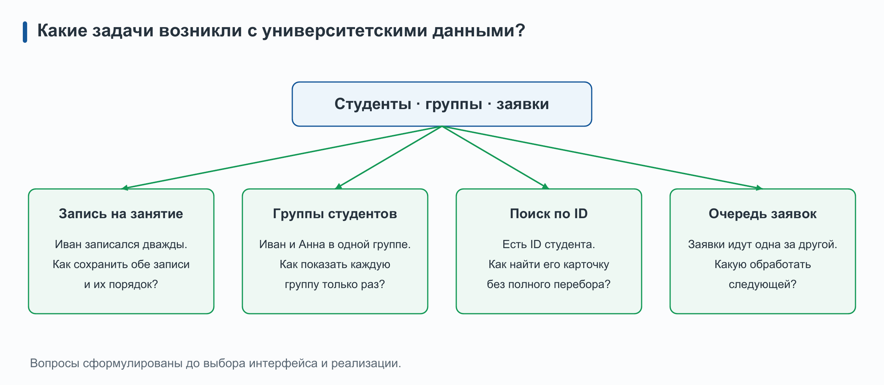

### 2. Почему Framework устроен как иерархия

Общие операции не нужно придумывать заново для каждого контейнера. Интерфейс **`Iterable`** задаёт обход, **`Collection`** добавляет работу с набором элементов (`size`, `contains`, `add`, `remove`). Дальше контракт уточняется под задачу:

- **`List`** добавляет позиции и операции по индексу;
- **`Set`** усиливает правило уникальности, не вводя индексов;
- **`Queue`** задаёт получение следующего элемента, **`Deque`** — операции с обоими концами;
- **`Map`** стоит отдельно: клиент ищет значение *по ключу*, а не элемент набора.

В Java 21 между некоторыми уровнями находятся `SequencedCollection`, `SequencedSet` и `SequencedMap`: они выражают определённый порядок обхода и операции с его концами. Схема показывает нужные нам связи и основные операции, но не все типы библиотеки. **Абстрактные классы** вроде `AbstractList` дают разработчику часть реализации; **конкретные классы** вроде `ArrayList` уже хранят данные. [Иерархия Java 21](https://docs.oracle.com/en/java/javase/21/docs/api/java.base/java/util/doc-files/coll-reference.html), [SequencedCollection](https://docs.oracle.com/en/java/javase/21/docs/api/java.base/java/util/SequencedCollection.html).

[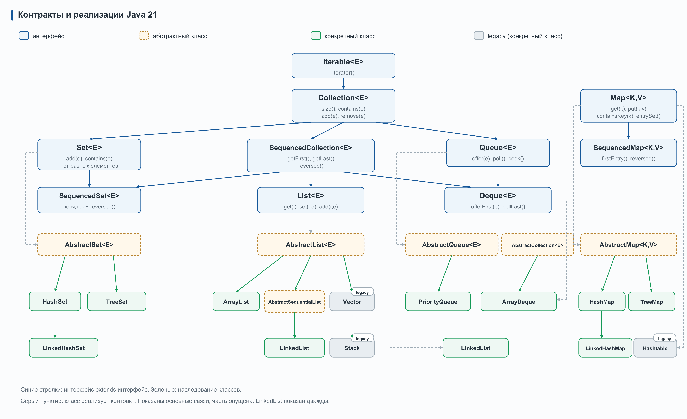](../../resources/lectures/2026-fall/collections-internals/framework-hierarchy.svg)

*Нажмите на схему, чтобы открыть её в полном размере.*

Три похожих названия:

| Имя | Что это |
| --- | --- |
| **Collections Framework** | Система контрактов, классов и алгоритмов |
| **`Collection<E>`** | Интерфейс для набора элементов; общие `size()`, `isEmpty()`, `contains(...)` |
| **`Collections`** | Служебный класс со статическими методами, например `sort(...)` |

Запись `List<Student> registrations = new ArrayList<>();` использует знакомый полиморфизм: переменная обещает операции `List`, объект реализует их через `ArrayList`. `Student` — тип элемента; примитивы в generic-аргументах заменяются обёртками, поэтому ID в `Map` имеет тип `Integer`.

**Старые классы, которые можно встретить в чужом коде:**

| Старый класс | Для обычного нового кода | Почему |
| --- | --- | --- |
| `Vector` | `ArrayList` | Старый синхронизированный список; без требования потокобезопасности Oracle рекомендует `ArrayList`. |
| `Hashtable` | `HashMap` | Старая синхронизированная таблица; без требования потокобезопасности Oracle рекомендует `HashMap`. |
| `Stack` | `Deque` с `ArrayDeque` | `Deque` даёт более полный и согласованный набор операций стека. |

Если понадобится совместное изменение коллекции из нескольких потоков, выбор будет отдельной темой; синхронизация отдельного метода старого класса сама по себе не решает все задачи конкурентного доступа. [Vector](https://docs.oracle.com/en/java/javase/21/docs/api/java.base/java/util/Vector.html), [Hashtable](https://docs.oracle.com/en/java/javase/21/docs/api/java.base/java/util/Hashtable.html), [Stack](https://docs.oracle.com/en/java/javase/21/docs/api/java.base/java/util/Stack.html).

### 3. `List`: позиция, порядок, повторы

`List` — **интерфейс для списков**: он описывает последовательность элементов и обращение по индексу. Контракт не требует уникальности: обычный `ArrayList` допускает повторы. Для изменяемого списка начните с `ArrayList`; `LinkedList` исполняет тот же контракт, но иначе платит за операции. Стоимость разберём во второй части.

| Метод | Результат |
| --- | --- |
| `add(e)` / `add(i, e)` | Добавить в конец / перед позицией `i` |
| `get(i)` / `set(i, e)` | Прочитать / заменить элемент; `set` возвращает прежний |
| `remove(i)` / `remove(e)` | Удалить позицию / первый равный элемент; возвращают элемент / `boolean` |
| `indexOf(e)` / `contains(e)` | Найти первую позицию / проверить наличие |
| `size()` / `isEmpty()` | Число элементов / пуст ли список |

Ниже и далее — **короткие фрагменты внутри `main`**. Импорты `java.util.*` и типов `university.model.*` опущены. Мы продолжаем модель прошлой лекции: `UniversityGroup` — уже знакомый `record`; для примеров считаем, что `Student` имеет конструктор `(int id, String name, UniversityGroup group)` и методы `getId()`, `getName()`, `getGroup()`. Полное объявление студента здесь не требуется. Общие исходные объекты:

```java
Student ivan = new Student(1, "Иван", new UniversityGroup("24.Б11-мм"));
Student anna = new Student(2, "Анна", new UniversityGroup("24.Б11-мм"));
```

```java
List<Student> registrations = new ArrayList<>();
registrations.add(ivan);
registrations.add(anna);
registrations.add(ivan);
System.out.println(registrations.size());       // 3
System.out.println(registrations.get(2) == ivan); // true
```

Две позиции хранят ссылки на одного Ивана; `add` не копирует объект. После `remove(0)` прежние позиции 1 и 2 получат индексы 0 и 1. В `List<Integer>` вызов `remove(1)` выбирает **индекс**, а `remove(Integer.valueOf(1))` — **значение**; это две перегрузки, а не одна операция. Контракт методов — [List API](https://docs.oracle.com/en/java/javase/21/docs/api/java.base/java/util/List.html).

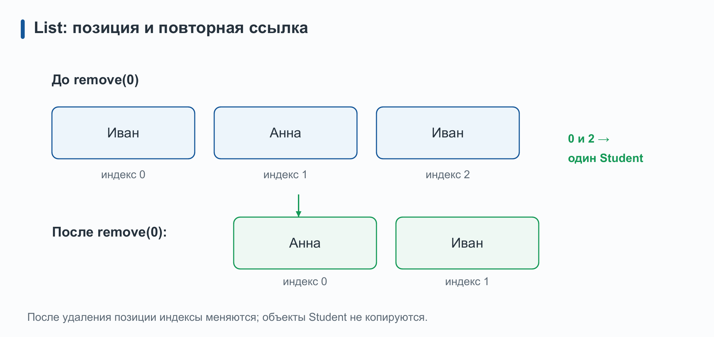

### 4. `Set`: логическая уникальность

`Set` — **интерфейс для множеств**: он описывает набор без равных элементов и отвечает на вопрос «есть ли уже такой элемент?». Индексов в нём нет. Равенство задаёт тип элемента. Два `UniversityGroup` с одним именем — разные объекты, но равные значения record. Для `HashSet` согласованность `equals` и `hashCode` обязательна; её смысл знаком по [лекции 4](/lectures/autumn/lecture_04.html).

| Метод | Результат |
| --- | --- |
| `add(e)` | `true`, если множество изменилось; равный элемент повторно не добавится |
| `contains(e)` | Есть ли равный элемент |
| `remove(e)` | `true`, если равный элемент удалён |
| `size()` / `isEmpty()` | Число разных элементов / пусто ли множество |

```java
Set<UniversityGroup> groups = new HashSet<>();
System.out.println(groups.add(ivan.getGroup())); // true
System.out.println(groups.add(anna.getGroup())); // false
System.out.println(groups.size());                // 1
```

Не выводите порядок из того, как `HashSet` однажды напечатался: [он не обещает порядок обхода](https://docs.oracle.com/en/java/javase/21/docs/api/java.base/java/util/HashSet.html). `LinkedHashSet` в обычном режиме поддерживает порядок добавления, `TreeSet` — порядок сравнения. У `TreeSet` сравнение определяет также, считаются ли элементы дубликатами: оно должно быть согласовано с желаемым смыслом уникальности. `UniversityGroup` как record сам по себе не имеет естественного порядка.

### 5. `Map`: поиск по ключу

`Map<K,V>` — **интерфейс для отображений**: он описывает связи **ключ → значение** и поиск значения по ключу. Ключи уникальны, значения могут повторяться. `put` с уже имеющимся ключом заменяет значение. Здесь ключ — неизменяемый `Integer` ID, значение — студент.

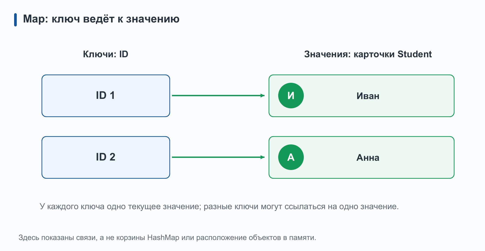

| Метод | Результат |
| --- | --- |
| `put(k, v)` | Создать или заменить связь; вернуть прежнее значение либо `null` |
| `get(k)` / `getOrDefault(k, d)` | Значение по ключу / запасное значение при отсутствии связи |
| `containsKey(k)` / `containsValue(v)` | Проверить ключ / значение; назначение и цена различаются |
| `remove(k)` | Удалить связь, вернуть прежнее значение либо `null` |
| `keySet()` / `values()` / `entrySet()` | Представления ключей / значений / пар |

```java
Map<Integer, Student> studentsById = new HashMap<>();
studentsById.put(ivan.getId(), ivan);
studentsById.put(anna.getId(), anna);
System.out.println(studentsById.get(2).getName()); // Анна
System.out.println(studentsById.put(2, ivan) == anna); // true
System.out.println(studentsById.size()); // 2: значение заменено
```

`HashMap` допускает `null` значения: поэтому `get(k) == null` **не доказывает**, что ключа нет; проверьте `containsKey(k)`. Ключу, помещённому в хеш-таблицу, нельзя менять поля, от которых зависят `equals`/`hashCode`: последующий поиск может потерять его. Для ID здесь выбран `Integer`, а не изменяемый `Student`. У `HashMap` также [нет гарантии порядка](https://docs.oracle.com/en/java/javase/21/docs/api/java.base/java/util/HashMap.html). С контрактом методов можно свериться в [Map API](https://docs.oracle.com/en/java/javase/21/docs/api/java.base/java/util/Map.html).

`containsKey` ищет через хеш ключа; `containsValue` проверяет значения перебором записей. Поэтому быстрый поиск по ключу не делает столь же быстрым поиск по значению.

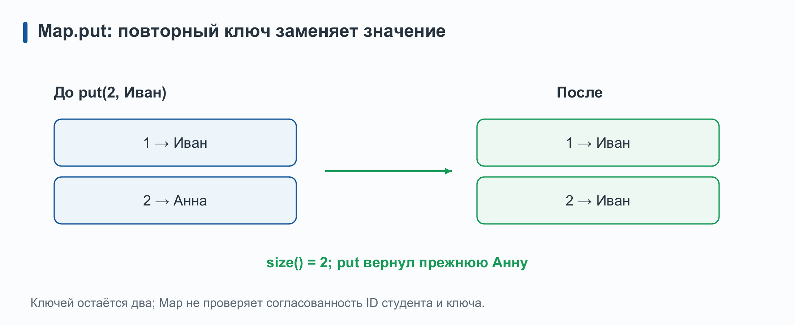

### 6. Очередь и стек: FIFO, LIFO, `Deque`

**FIFO** (*first in, first out*) — первым пришёл, первым вышел; так обрабатываем заявки. **LIFO** (*last in, first out*) — последним положили, первым взяли; так работает стек действий. `Queue` — **интерфейс для очередей**: он описывает добавление, просмотр и извлечение следующего элемента. `Deque` — интерфейс двусторонней очереди: операции на разных концах дают FIFO, на одном конце — LIFO. Для обоих сценариев подходит `ArrayDeque`.

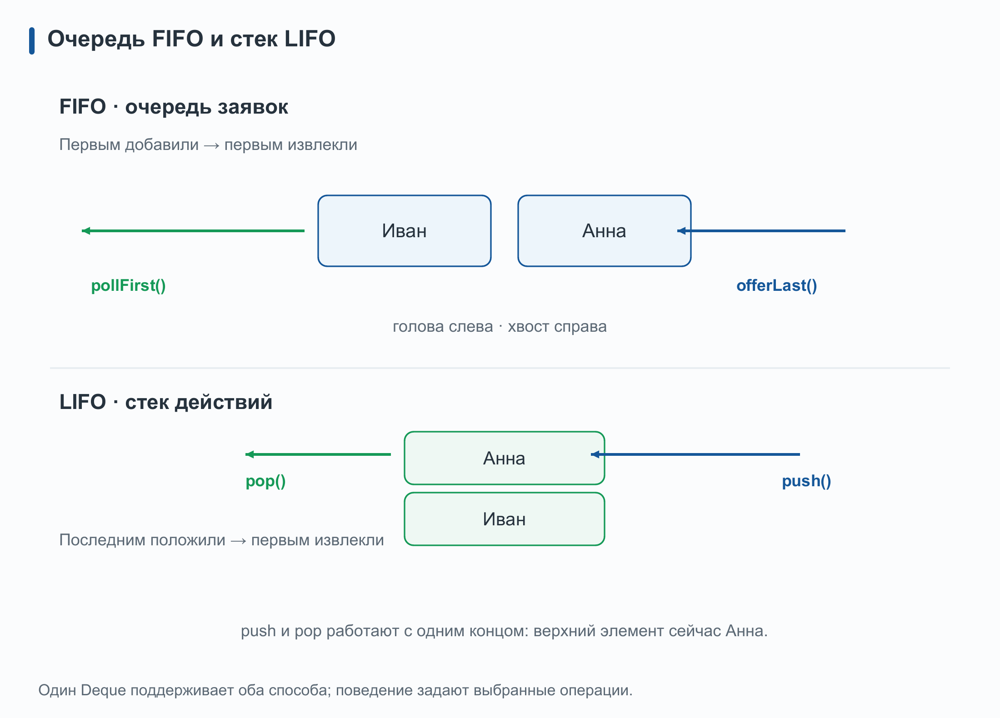

Не каждая реализация `Queue` следует времени поступления: `PriorityQueue` выдаёт элемент по приоритету. Здесь нам нужна именно очередь заявок по времени.

| Задача | Методы с особым значением при неуспехе | Методы с исключением при неуспехе |
| --- | --- | --- |
| Добавить в очередь | `offer(e)` | `add(e)` |
| Взять голову | `poll()` → `null`, если пусто | `remove()` |
| Посмотреть голову | `peek()` → `null`, если пусто | `element()` |

Для `Deque` стороны называются `First` и `Last`: `offerLast(e)` добавляет в конец, `pollFirst()` берёт с начала; симметричные `offerFirst`, `pollLast`, `peekFirst`, `peekLast` работают с другим концом. `push(e)`/`pop()` делают стек на **первом** конце. В `ArrayDeque` нельзя положить `null`, потому что `poll` и `peek` используют его как признак пустоты. [Deque API](https://docs.oracle.com/en/java/javase/21/docs/api/java.base/java/util/Deque.html), [ArrayDeque API](https://docs.oracle.com/en/java/javase/21/docs/api/java.base/java/util/ArrayDeque.html).

```java
Deque<String> applications = new ArrayDeque<>();
applications.offerLast("Иван");
applications.offerLast("Анна");
System.out.println(applications.pollFirst()); // Иван: FIFO

Deque<String> history = new ArrayDeque<>();
history.push("Иван");
history.push("Анна");
System.out.println(history.pop()); // Анна: LIFO
```

### 7. Обход: `Iterable`, `Iterator`, представления `Map`

`Iterable<E>` — интерфейс для того, по чему можно пройти: его `iterator()` возвращает **объект обхода** `Iterator<E>`. `Collection` наследует `Iterable`, а `Iterator` помнит текущую позицию. `for-each` вызывает эти операции за нас. Сам `Map` не является `Iterable`: для пар нужен `entrySet()`.

| Интерфейс и метод | Что делает |
| --- | --- |
| `Iterable.iterator()` | Возвращает итератор для обхода элементов |
| `Iterator.hasNext()` | Проверяет, есть ли следующий элемент |
| `Iterator.next()` | Возвращает следующий элемент и продвигает курсор; при завершённом обходе выбрасывает исключение |
| `Iterator.remove()` | Удаляет последний выданный `next()` элемент, если реализация поддерживает удаление |

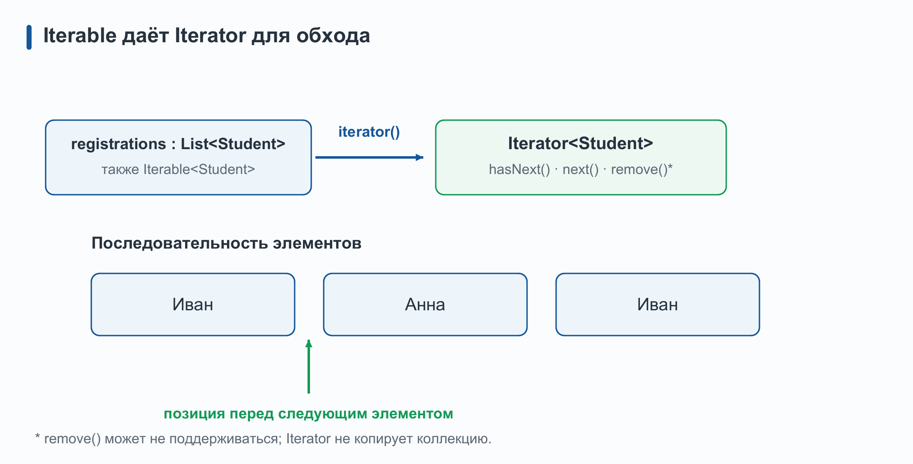

```java
for (Student student : registrations) {
  System.out.println(student.getName());
}

for (Map.Entry<Integer, Student> entry : studentsById.entrySet()) {
  System.out.println(entry.getKey() + ": " + entry.getValue().getName());
}
```

Второй цикл **не обещает порядка строк**, потому что `studentsById` — `HashMap`. `keySet()`, `values()` и `entrySet()` возвращают **представления**, связанные с исходной картой, а не снимки. Например, после `studentsById.remove(1)` ключ `1` исчезнет и из ранее полученного `keySet`. [Map API](https://docs.oracle.com/en/java/javase/21/docs/api/java.base/java/util/Map.html).

Когда нужно удалять во время обхода, используйте поддерживаемый `Iterator.remove()` после `next()`:

```java
Iterator<Student> it = registrations.iterator();
while (it.hasNext()) {
  if (it.next().getId() == 1) it.remove();
}
```

Не изменяйте тот же список напрямую внутри `for-each`. У распространённых реализаций это может обнаружиться как `ConcurrentModificationException`, но [fail-fast — диагностика best effort](https://docs.oracle.com/en/java/javase/21/docs/api/java.base/java/util/ConcurrentModificationException.html), не способ управлять программой. Во второй части увидим, почему для `LinkedList` последовательный обход итератором существенно дешевле повторного `get(i)`.

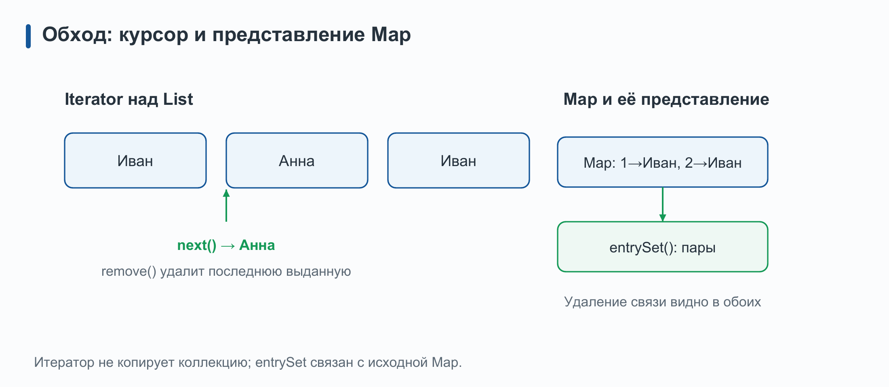

### 8. Порядок, сортировка и изменяемость

Один интерфейс могут реализовать разные классы. Они дают похожие операции, но отличаются хранением, порядком обхода и стоимостью. Ниже — **основные доступные контракты**, а не полный список прямых `implements` каждого класса:

| Класс | Основные интерфейсы | Что это за реализация |
| --- | --- | --- |
| `ArrayList` | `List` | расширяемый массив |
| `LinkedList` | `List`, `Deque` | двусвязный список |
| `HashSet` | `Set` | хеш-множество |
| `LinkedHashSet` | `SequencedSet`, `Set` | хеш-множество; по умолчанию порядок добавления |
| `TreeSet` | `SequencedSet`, `Set` | множество в порядке сравнения |
| `HashMap` | `Map` | хеш-таблица |
| `LinkedHashMap` | `SequencedMap`, `Map` | хеш-таблица; по умолчанию порядок добавления |
| `TreeMap` | `SequencedMap`, `Map` | отображение с ключами в порядке сравнения |
| `ArrayDeque` | `Deque`, `Queue` | двусторонняя очередь на растущем кольцевом массиве |
| `PriorityQueue` | `Queue` | очередь с выбором головы по приоритету |

Старые `Vector`, `Stack` и `Hashtable` отмечены на схеме выше: `Stack` наследует `Vector` и тем самым относится к `List`, **а не к `Deque`**. Эти классы существуют в Java 21; *legacy* не означает аннотацию `@Deprecated`.

Сначала решите, какой именно порядок требуется:

| Требование | Пример выбора |
| --- | --- |
| Сохранить позиции и повторы | `ArrayList` |
| Уникальность без обещания порядка | `HashSet` |
| Уникальность с порядком добавления | `LinkedHashSet` |
| Поиск по ключу без обещания порядка | `HashMap` |
| Ключи в порядке добавления | `LinkedHashMap` |
| Элементы или ключи в порядке сравнения | `TreeSet` / `TreeMap` |

Для списка сортировка **меняет порядок того же списка**. Строки уже имеют естественный порядок (`Comparable`):

```java
List<String> names = new ArrayList<>(List.of("Иван", "Анна"));
names.sort(null);                 // естественный порядок String
System.out.println(names);       // [Анна, Иван]
```

`Comparator` задаёт другой порядок сравнения; способ записать его через лямбду обсудим на следующей лекции. У `TreeSet`/`TreeMap` порядок поддерживается при изменениях, в отличие от разовой сортировки списка. [List.sort](https://docs.oracle.com/en/java/javase/21/docs/api/java.base/java/util/List.html#sort(java.util.Comparator)), [Comparator API](https://docs.oracle.com/en/java/javase/21/docs/api/java.base/java/util/Comparator.html).

Создание `new ArrayList<>()` даёт изменяемый список, а `List.of(...)` — список, состав которого нельзя изменить. `List.copyOf(registrations)` фиксирует **состав на момент вызова**, но не копирует самих изменяемых студентов: если у `ivan` поменяется статус, тот же объект виден в снимке. `Set.of` отклоняет равные повторные элементы, `Set.copyOf` оставляет одного из них; фабрики `of`/`copyOf` не принимают `null`. [List API](https://docs.oracle.com/en/java/javase/21/docs/api/java.base/java/util/List.html), [Set API](https://docs.oracle.com/en/java/javase/21/docs/api/java.base/java/util/Set.html).

### 9. Выбор перед разбором внутренностей

| Вопрос программы | Контракт | Реализация для примера |
| --- | --- | --- |
| Кто записан и на какой позиции? | `List<Student>` | `ArrayList` |
| Какие группы представлены? | `Set<UniversityGroup>` | `HashSet` |
| Кто соответствует ID 2? | `Map<Integer, Student>` | `HashMap` |
| Чья заявка следующая? | `Deque<String>` | `ArrayDeque` |

Все четыре решения выражают нужный **контракт**. Но почему `get(2)` у `ArrayList` и `LinkedList` стоит по-разному? И на каком условии основан быстрый поиск `HashMap`? Чтобы ответить, заглянем в представление данных и посчитаем действия каждого метода.

<a id="part2"></a>

## Часть II. Что хранится внутри и откуда берётся стоимость

В первой части мы выбрали контракт для каждой задачи. Теперь посмотрим, сколько действий требует его конкретная реализация. Обозначим через **n** число элементов; доступ к ячейке массива, переход по одной ссылке и сравнение считаем отдельными элементарными действиями. `O(1)` здесь говорит о числе таких действий, а не обещает одинаковое время в наносекундах.

| Вид оценки | Что означает |
| --- | --- |
| **Худшая** | Верхняя граница для одного вызова при наиболее неудобных допустимых данных. |
| **Ожидаемая** | Оценка при условии о распределении данных, например хешей по корзинам. |
| **Амортизированная** | Средняя цена операции в *последовательности* вызовов: редкая дорогая операция оплачивается множеством дешёвых. Это не оценка одного случайного вызова. |

### Как растёт число действий

Пусть `n` — число элементов в коллекции. Мы считаем основные действия: сколько ячеек нужно прочитать, сравнений выполнить или ссылок передвинуть. **Большое `O`** показывает верхнюю границу роста этой работы при увеличении `n`, не учитывая постоянные множители и небольшие добавки.

| Что делаем | Сколько действий в худшем случае | Оценка роста |
| --- | --- | --- |
| `ArrayList.get(i)` | Обращаемся к одной ячейке | `O(1)` — не зависит от `n` |
| `ArrayList.contains(x)` | Сравниваем `x` с `n` элементами | `O(n)` — растёт вместе с `n` |
| Для каждого из `n` значений вызываем `contains(x)` | До `n × n` сравнений | `O(n²)` — растёт быстрее |

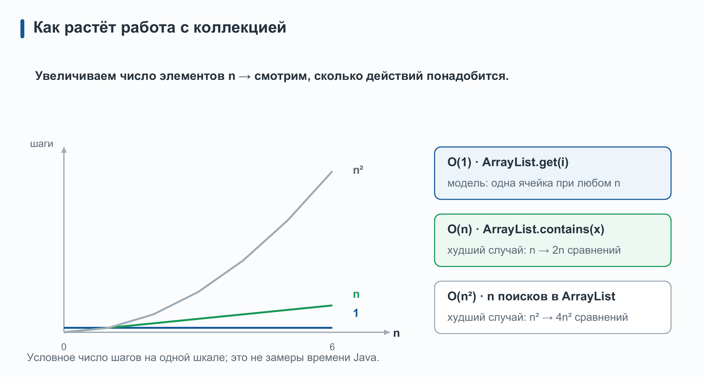

Читаем `O(n)` как «**не быстрее линейного роста** при достаточно больших `n`». Это не «ровно `n` действий»: один просмотр может требовать несколько действий. В этой лекции мы будем указывать, **какую** стоимость ограничиваем: худшую, ожидаемую или амортизированную. Само `O` не означает «худший случай». [MIT 6.006: вводная лекция](https://ocw.mit.edu/courses/6-006-introduction-to-algorithms-spring-2020/477c78e0af2df61fa205bcc6cb613ceb_MIT6_006S20_lec1.pdf).

### `ArrayList`: размер, ёмкость, сдвиг

`ArrayList<E>` наследует абстрактный `AbstractList<E>` и реализует интерфейс `List<E>`. Это список на основе **расширяемого массива**: элементы имеют позиции, доступны по индексу и могут повторяться.

Внутри массив хранит ссылки на элементы. **Размер** — сколько элементов списка занято; **ёмкость** — сколько ссылок помещается до расширения. Заняты ячейки от `0` до `size - 1`. Пустые ячейки внутреннего массива не являются элементами списка.

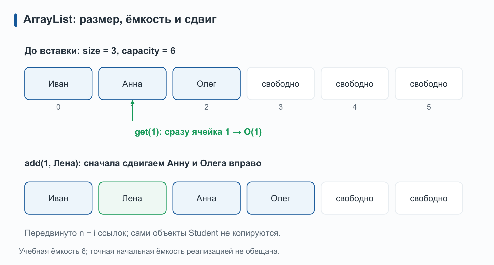

**Чтение `get(i)`**: адрес ячейки определяется по индексу, без просмотра предшествующих элементов → `O(1)`. `set(i, value)` так же заменяет одну ссылку. `contains(value)` ищет совпадение последовательно → `O(n)`.

**Вставка `add(i, value)`**: чтобы освободить ячейку `i`, надо сдвинуть вправо `n - i` ссылок. Вставка у начала требует `O(n)`; добавление в конец без расширения — `O(1)`. Удаление `remove(i)` сдвигает влево ссылки после удалённой: до `n - i - 1` перемещений. Если удалить последний элемент, сдвига нет.

Когда свободной ячейки нет, создаётся больший массив и в него копируются `n` ссылок: отдельное добавление тогда стоит `O(n)`. Почему всё же принято писать для `add(E)` **амортизированное `O(1)`**? В учебной модели с удвоением ёмкости, чтобы добавить `n` элементов, копирования происходят на размерах примерно `1, 2, 4, 8, …`. Сумма меньше `2n`; вместе с `n` обычными записями это `O(n)` за всю серию, или `O(1)` на добавление. Конкретный множитель роста Java API не обещает, но саму амортизированную оценку [документация `ArrayList` для Java 21](https://docs.oracle.com/en/java/javase/21/docs/api/java.base/java/util/ArrayList.html) указывает прямо.

**Проверьте себя.** У списка из `n` элементов достаточно свободной ёмкости. Сколько ссылок передвинет `add(0, student)`? А `add(n, student)`? Ответы: `n` и `0`.

### `LinkedList`: ссылки вместо сдвига массива

`LinkedList<E>` наследует абстрактный `AbstractSequentialList<E>` и реализует интерфейсы `List<E>` и `Deque<E>`. Это **двусвязный список**: он даёт и операции по индексу, и работу с обоими концами.

Каждый элемент находится в отдельном узле. Узел хранит элемент и две ссылки — на предыдущий и следующий узлы; список знает первый и последний.

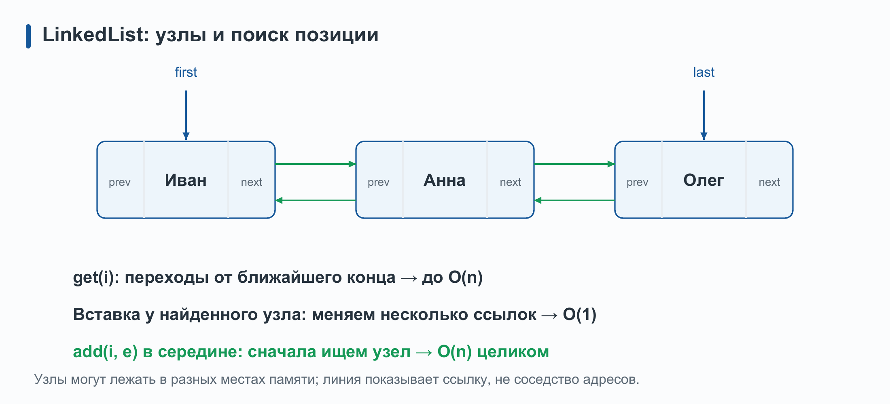

- `get(i)` начинает с ближнего конца и идёт по ссылкам до нужного узла: `O(1 + min(i, n - 1 - i))`, в середине — `O(n)`.
- `addFirst`, `addLast`, `removeFirst`, `removeLast` обновляют лишь несколько ссылок: `O(1)`.
- Вставка или удаление **у уже найденного узла** требует `O(1)` обновлений ссылок. Но вызов `add(i, value)` сначала ищет позицию; его полная стоимость в середине — `O(n)`.
- `contains(value)` проверяет узлы один за другим: `O(n)`.

Отсюда ловушка индексного обхода:

```java
// Фрагмент: linked — непустой или пустой LinkedList<Student>.
for (int i = 0; i < linked.size(); i++) {
  Student student = linked.get(i);
  // Используем student.
}
```

Каждый `get(i)` снова проходит часть списка. Суммарное число переходов растёт как `1 + 2 + … + n/2`, то есть `O(n²)`. `for-each` использует итератор, который после каждого элемента переходит к соседнему узлу:

```java
for (Student student : linked) {
  // Используем student.
}
```

Здесь один проход стоит `O(n)`. Для `ArrayList` оба способа обхода линейны, но `for-each` выражает намерение яснее. Свойство поиска от ближнего конца указано в [API `LinkedList` Java 21](https://docs.oracle.com/en/java/javase/21/docs/api/java.base/java/util/LinkedList.html).

**Вывод:** выбирать `LinkedList` только по фразе «вставка за `O(1)`» нельзя. Надо знать, откуда возьмётся позиция вставки и нужен ли доступ по индексу. Кроме того, отдельные узлы и ссылки требуют дополнительной памяти.

### `HashMap`: массив корзин и равенство ключей

`HashMap<K, V>` наследует абстрактный `AbstractMap<K, V>` и реализует интерфейс `Map<K, V>`. Это **хеш-таблица** для хранения пар «ключ → значение»; в отличие от `List` и `Set`, она не является `Collection`.

Для `studentsById.get(id)` хочется найти студента, не просматривая все записи. `HashMap` использует массив **корзин**. Ключ даёт `hashCode`; из хеша вычисляется индекс корзины. В корзине хранятся записи `(ключ, значение)`. Разные ключи могут попасть в одну корзину — это **коллизия**, а не ошибка.

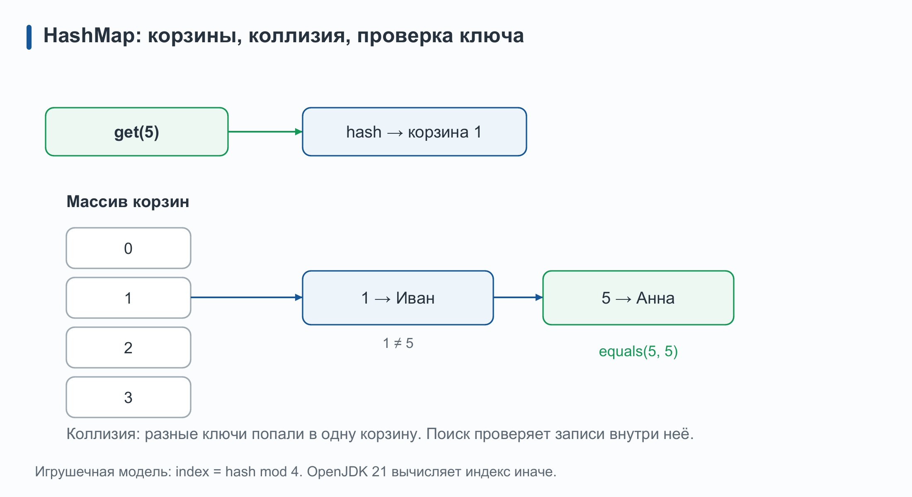

Упрощённая логика `get(key)` — **псевдокод, не Java API и не буквальный исходник OpenJDK**:

```text
hash = (key == null ? 0 : hashCode(key))
bucket = bucketFor(hash, capacity)
for each entry in bucket:
    if entry.hash == hash and keysEqual(entry.key, key):
        return entry.value
return null
```

`keysEqual` означает сравнение ключей по контракту `equals` (с учётом случая `null`). `put(key, value)` проходит ту же корзину: для равного ключа меняет значение, иначе добавляет новую запись. Поэтому два разных объекта-ключа, которые равны по `equals`, должны иметь одинаковый `hashCode`; иначе поиск может пойти в другую корзину. Это контракт из [лекции 4](/lectures/autumn/lecture_04.html), а не особое свойство `record`.

Для основного примера безопасный ключ — неизменяемый `Integer` ID:

```java
Map<Integer, Student> studentsById = new HashMap<>();
studentsById.put(1, ivan);
studentsById.put(1, anna); // Та же запись: теперь ID 1 связан с anna.
```

Состояние самого `Student` может изменяться без изменения ключа. Если же сделать ключом изменяемый объект и поменять поле, участвующее в `equals`/`hashCode`, запись останется в прежней корзине, а последующий поиск может её не найти. `HashMap` не перестраивает таблицу при изменении полей уже вставленного ключа.

#### Загрузка таблицы и расширение

Обозначим `m` число записей, `c` число корзин. Отношение `m / c` называют **коэффициентом заполнения**. Если записей становится много, цепочки в корзинах в среднем удлиняются. `HashMap` расширяет таблицу при превышении порога `capacity × loadFactor`, затем перераспределяет записи по новым корзинам. Стандартное значение load factor в Java 21 — `0.75`; это компромисс между памятью и длиной поиска, а не «таблица заполнена на 75%»: несколько ключей могут занимать одну корзину, а другие оставаться пустыми. [API `HashMap` Java 21](https://docs.oracle.com/en/java/javase/21/docs/api/java.base/java/util/HashMap.html).

**Ручная трассировка — учебная модель, не точные значения OpenJDK.** Пусть `c = 4`, порог равен `3`, а индекс равен `hash mod c`. Ключи `1`, `5`, `2` дают корзины `1`, `1`, `2`. После добавления четвёртого ключа `3` порог превышен: новая таблица имеет `c = 8`; ключи `1` и `5` теперь расходятся по корзинам `1` и `5`. Перемещение всех записей при одном расширении стоит `O(m)`.

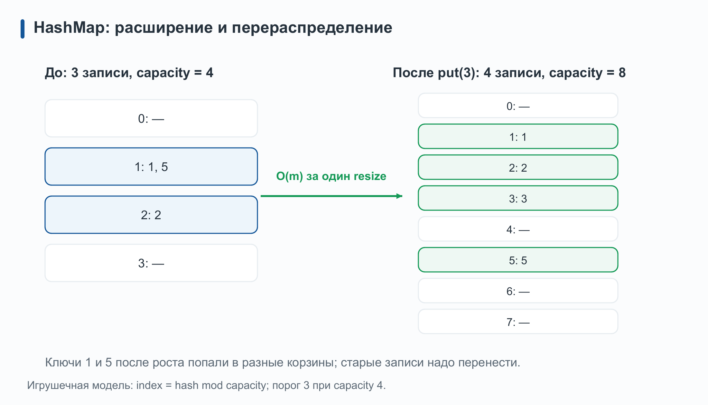

#### Откуда берётся `O(1)` и где оно заканчивается

При хорошем распределении хешей и контролируемой загрузке в одной корзине ожидается небольшое число записей. Тогда вычислить индекс и проверить корзину можно за **ожидаемое `O(1)`**. Редкое расширение стоит `O(m)`, поэтому `put` рассматривают также как амортизированную операцию по серии вставок. При множестве коллизий путь поиска удлиняется; `O(1)` не является гарантией худшего случая. Если ключи имеют одинаковый хеш и их нельзя эффективно упорядочить, поиск в худшем случае может проверить `O(m)` записей.

В OpenJDK 21 слишком длинная корзина *при достаточной ёмкости таблицы* может преобразоваться из цепочки в дерево. Это защита от части плохих случаев, но она не меняет контракт `Map` и не даёт универсального обещания `O(log n)` для любого ключа. [Исходник `HashMap` OpenJDK 21](https://github.com/openjdk/jdk21u/blob/master/src/java.base/share/classes/java/util/HashMap.java) содержит и узлы цепочки, и дерево, и логику расширения.

Обход `keySet()` или `entrySet()` проверяет также пустые корзины. Поэтому для `HashMap` его цена — `O(c + m)`, где `c` — ёмкость, `m` — число записей. Слишком большая заранее заданная ёмкость может замедлить полный обход, хотя отдельный поиск остаётся быстрым. `HashMap` не гарантирует порядок обхода.

### `HashSet`: та же таблица, только без пользовательского значения

`HashSet<E>` наследует абстрактный `AbstractSet<E>` и реализует интерфейс `Set<E>`. Это множество на основе хеш-таблицы: равные элементы хранятся один раз, порядок обхода не гарантирован.

Внутри он использует `HashMap<E, Object>`: элемент множества становится **ключом**, а значение у каждой записи — одна служебная константа. Это схема реализации, не видимый пользователю тип `HashSet`.

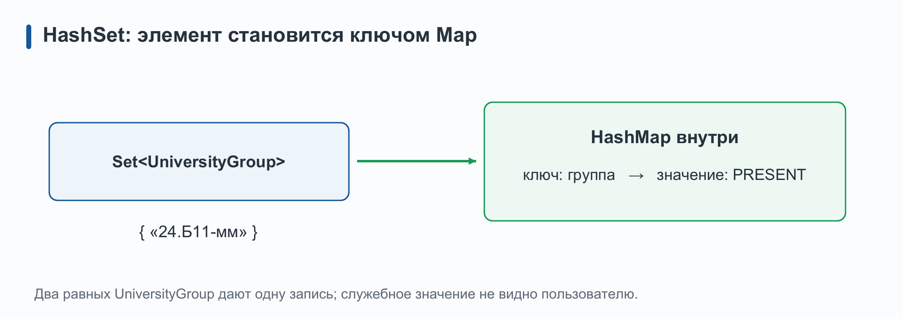

В пустое множество первый `new UniversityGroup("24.Б11-мм")` добавляется. При добавлении второго, равного ему объекта, `HashSet` находит существующий ключ, не добавляет дубликат и возвращает `false`. `contains` и `remove` повторяют поиск ключа в таблице. Поэтому их **ожидаемая** стоимость при хорошем распределении хешей — `O(1)`; плохие хеши ухудшают её, а обход требует `O(capacity + size)`. [API `HashSet` Java 21](https://docs.oracle.com/en/java/javase/21/docs/api/java.base/java/util/HashSet.html).

### `ArrayDeque`: два конца одного массива

`ArrayDeque<E>` наследует абстрактный `AbstractCollection<E>` и реализует интерфейс `Deque<E>` (а через него — `Queue<E>`). Это двусторонняя очередь на основе **расширяемого кольцевого массива**: элементы можно добавлять и извлекать с обоих концов.

**Кольцевой** не означает, что сам массив круглый. Он обычный, но после последнего индекса следующий индекс снова `0`. `head` указывает на первый элемент, `tail` — на свободную ячейку для добавления в конец. После предыдущих удалений `head` может оказаться у края массива. Поэтому физически `[B, C, пусто, A]` означает логический порядок **A → B → C**: начинаем с `head = 3` и переходим с индекса `3` на `0`.

Если добавить `D` в последнюю свободную ячейку, массив на мгновение окажется заполнен. `ArrayDeque` создаст больший массив и перенесёт нужные ссылки; порядок элементов для вызывающего кода останется **A → B → C → D**. После завершения операции снова есть свободные ячейки. На схеме показан конкретный случай для **OpenJDK 21**: внутренний массив растёт с 4 до 10 ячеек, а `A` перемещается с индекса `3` на `9`. Это деталь реализации, а не обещанный API размер или способ перестройки. [Исходник OpenJDK 21](https://github.com/openjdk/jdk21u/blob/master/src/java.base/share/classes/java/util/ArrayDeque.java).

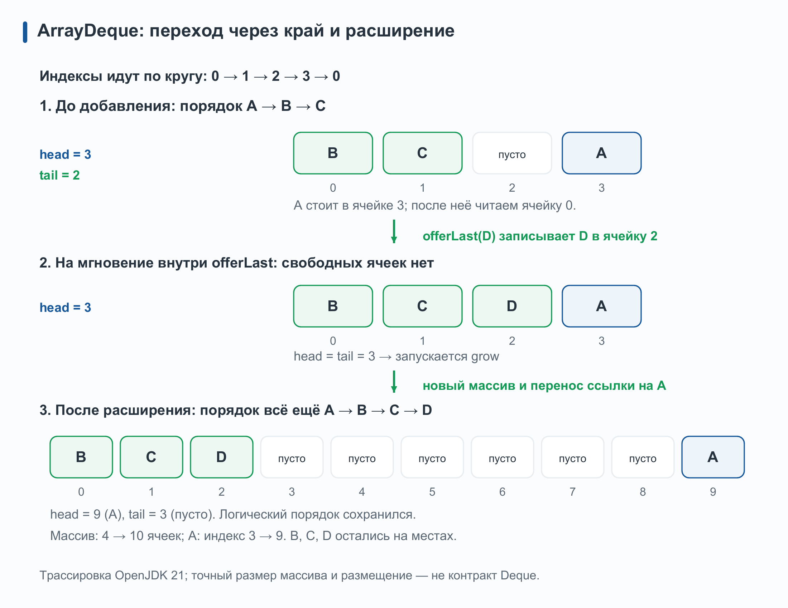

Без расширения операция на конце меняет лишь несколько индексов и ячеек: `O(1)`. Редкая перестройка переносит `O(n)` ссылок; поэтому за длинную серию добавлений получаем **амортизированное `O(1)`** на операцию. `contains` и удаление заданного элемента ищут его последовательно — `O(n)`. `ArrayDeque` не принимает `null`, поэтому `pollFirst() == null` однозначно означает пустую очередь. [API `ArrayDeque` Java 21](https://docs.oracle.com/en/java/javase/21/docs/api/java.base/java/util/ArrayDeque.html).

<a id="complexity"></a>

### Сравним полную цену операции

`n` — число элементов; `c` — ёмкость хеш-таблицы. У `HashMap`/`HashSet` `O(1)` в таблице — **ожидаемая оценка при хорошем распределении хешей**. У добавления в расширяемый массив — **амортизированная**.

| Задача | `ArrayList` | `LinkedList` | `HashMap` | `HashSet` | `ArrayDeque` |
| --- | --- | --- | --- | --- | --- |
| Доступ по индексу | `O(1)` | `O(n)` в середине | — | — | — |
| Поиск элемента / значения | `contains`: `O(n)` | `contains`: `O(n)` | `containsValue`: `O(c+n)` | `contains`: ожидаемо `O(1)` | `contains`: `O(n)` |
| Поиск по ключу | — | — | `get` / `containsKey`: ожидаемо `O(1)` | — | — |
| Добавление в конец | Амортизированно `O(1)` | `O(1)` | — | — | Амортизированно `O(1)` |
| Вставка/удаление в середине по индексу | `O(n)` из-за сдвига | `O(n)` из-за поиска узла | — | — | — |
| `put` / `add` по хешу | — | — | Ожидаемо `O(1)`; resize `O(n)` отдельно | Ожидаемо `O(1)`; resize `O(n)` отдельно | — |
| Полный обход | `O(n)` | `O(n)` через итератор | `O(c+n)` | `O(c+n)` | `O(n)` |

Таблица помогает проверить рассуждение, но выбор начинается с вопроса задачи. **Список записей** допускает повторы и частый доступ по позиции → `ArrayList`. **Уникальные группы** → `HashSet`, если порядок не нужен. **Поиск студента по ID** → `HashMap`. **Обработка заявок** по очереди или как стек → `ArrayDeque`. В следующей теме мы научимся выражать операции над такими последовательностями через функциональные интерфейсы, лямбды и Stream API; стоимость исходной коллекции при этом никуда не исчезнет.

<a id="reading"></a>

## Дополнительное чтение

- [Oracle: Collections Framework в Java 21](https://docs.oracle.com/en/java/javase/21/docs/api/java.base/java/util/doc-files/coll-overview.html) — официальная карта интерфейсов и реализаций.
- [Oracle: `ArrayList`](https://docs.oracle.com/en/java/javase/21/docs/api/java.base/java/util/ArrayList.html), [`LinkedList`](https://docs.oracle.com/en/java/javase/21/docs/api/java.base/java/util/LinkedList.html), [`HashMap`](https://docs.oracle.com/en/java/javase/21/docs/api/java.base/java/util/HashMap.html), [`HashSet`](https://docs.oracle.com/en/java/javase/21/docs/api/java.base/java/util/HashSet.html), [`ArrayDeque`](https://docs.oracle.com/en/java/javase/21/docs/api/java.base/java/util/ArrayDeque.html) — контракты и оговорки о стоимости.
- [Cornell CS 2110: хеширование](https://www.cs.cornell.edu/courses/cs2110/2025fa/lectures/lec20/) и [обход структур](https://www.cs.cornell.edu/courses/cs2110/2025fa/lectures/lec14/) — упражнения для закрепления.

**Самопроверка:** объясните, почему `add(0, e)` у `ArrayList` и `add(i, e)` у `LinkedList` в середине оба могут стоить `O(n)`, но по разным причинам. Что должно быть верно о ключах и распределении хешей, чтобы поиск в `HashMap` был ожидаемо `O(1)`?
