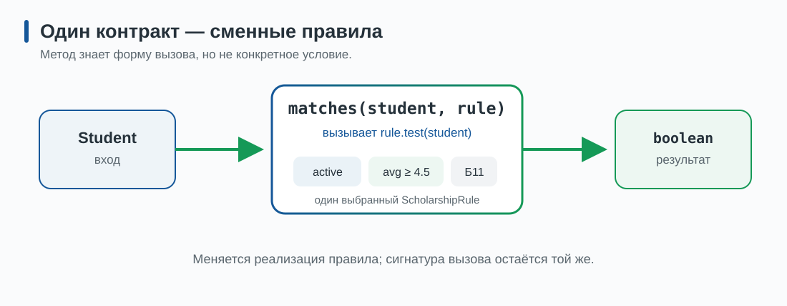
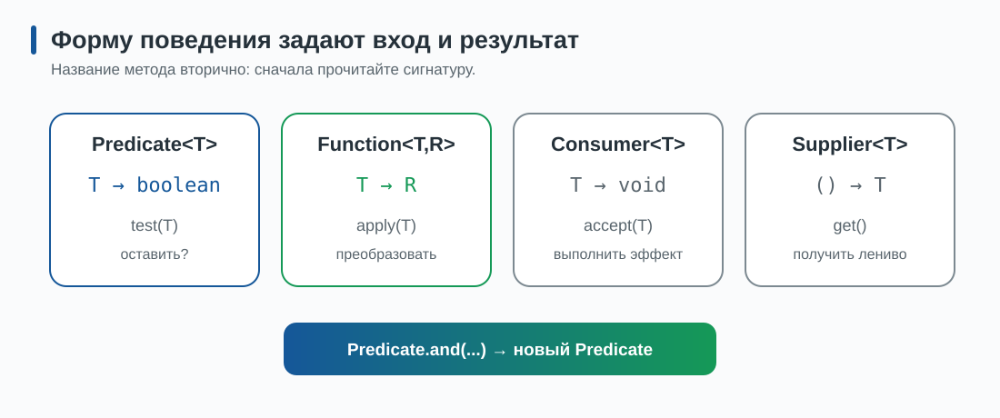
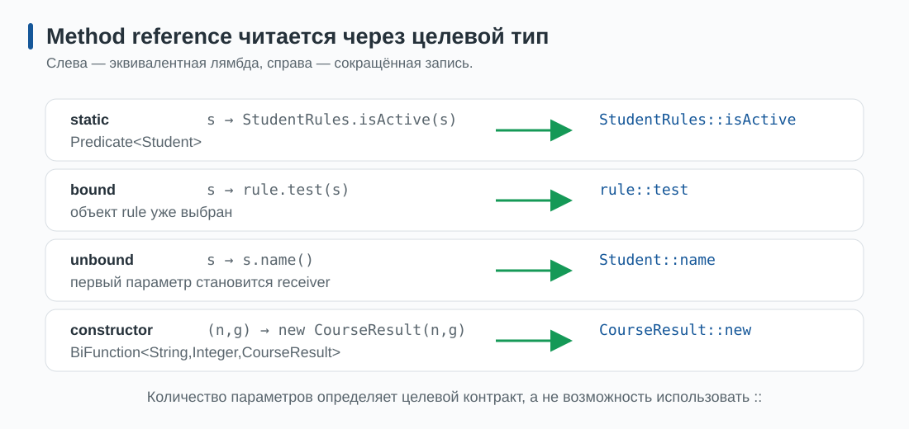
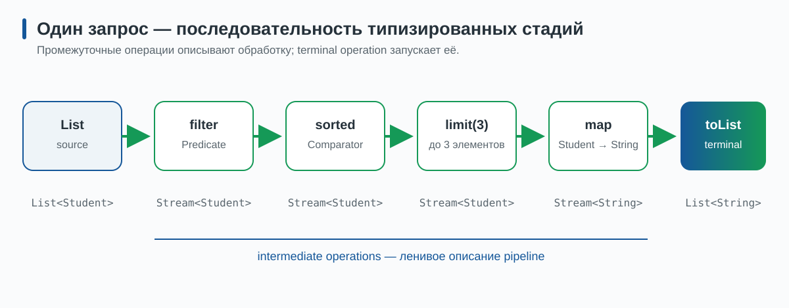
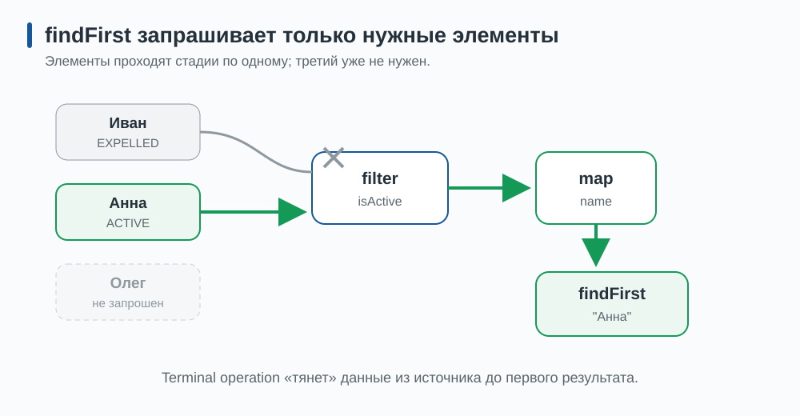
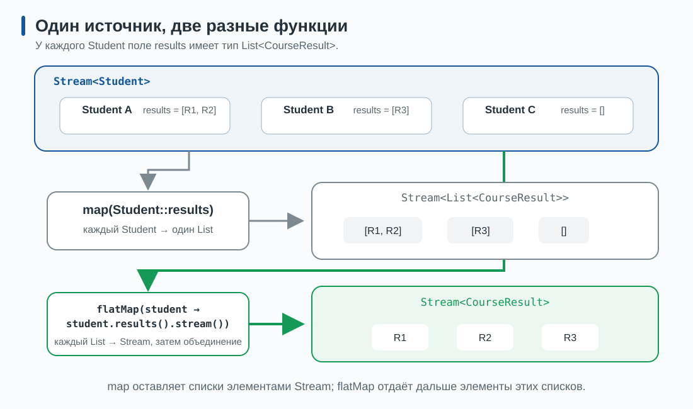
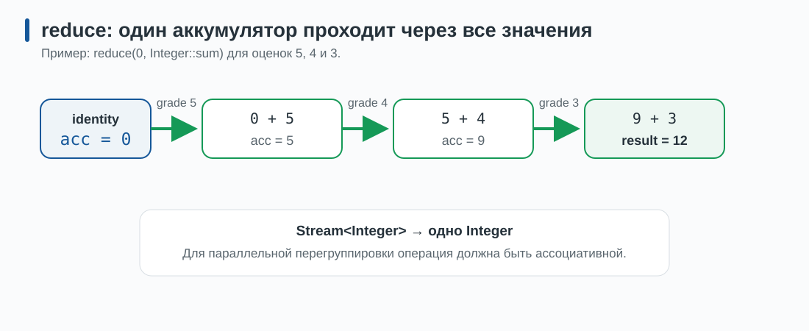
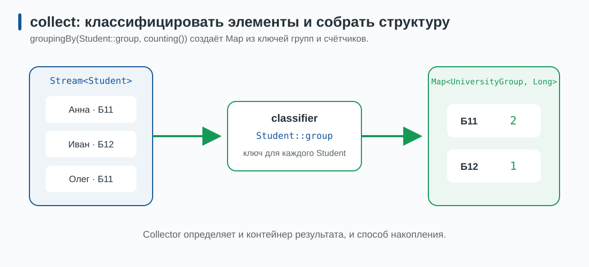
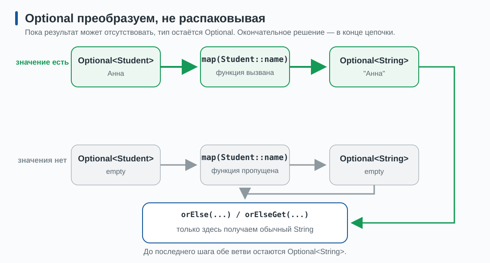

# Лекция 8. Функциональные интерфейсы, лямбды, Stream API и Optional

[Главная](/)

**Два занятия по 80 минут · Java 21.** Продолжение [лекции 7](/lectures/autumn/lecture_07.html): коллекции и обычный обход уже знакомы, теперь отделим правило обработки от механизма обхода.

### Содержание

1. [Поведение как значение](#part1)
   1. [Функциональный интерфейс, анонимный класс и lambda](#behavior-forms)
   2. [Стандартные интерфейсы, Comparator и ссылки на методы](#standard-functions)
2. [Stream API: конвейер обработки данных](#part2)
   1. [Pipeline, основные операции и ленивость](#stream-pipeline)
   2. [map, flatMap, reduce и collect](#stream-transformations)
3. [Optional: результат может отсутствовать](#optional)
4. [Вопросы для самопроверки](#questions)
5. [Дополнительное чтение](#reading)

## Данные сквозного примера

Продолжаем модель университета. Ниже — сокращённые объявления типов; проверки аргументов в конструкторах опущены.

```java
enum StudentStatus { ACTIVE, ACADEMIC_LEAVE, EXPELLED }

record UniversityGroup(String name) {}

record CourseResult(String course, int grade) {}

record Student(
        int id,
        String name,
        UniversityGroup group,
        StudentStatus status,
        List<CourseResult> results
) {}
```

Для правила стипендии считаем студента без оценок неподходящим. Поэтому вспомогательный метод возвращает для него значение ниже любого допустимого балла:

```java
static double averageGrade(Student student) {
    if (student.results().isEmpty()) {
        return Double.NEGATIVE_INFINITY;
    }

    int total = 0;
    for (CourseResult result : student.results()) {
        total += result.grade();
    }
    return (double) total / student.results().size();
}
```

Когда отсутствие среднего важно само по себе, не подменяем его числом и работаем с `OptionalDouble` напрямую.

<a id="part1"></a>

## Поведение как значение

### 1. Когда меняется не только значение, но и правило

В прошлой лекции мы обходили коллекции обычным циклом. Представим метод, который отбирает кандидатов на стипендию. Сам обход остаётся одинаковым, а условие меняется:

- сегодня — только активные студенты со средним баллом не ниже `4.5`;
- завтра — другой порог;
- для другого приказа — совсем другое правило.

Если зашить условие внутрь цикла, каждое новое правило потребует менять сам алгоритм отбора. Вместо этого метод может получить **поведение** через параметр с известным контрактом.

```java
static boolean matches(Student student, ScholarshipRule rule) {
    return rule.test(student);
}
```

`matches` не знает, *какое* условие проверяется. Он знает только способ его вызвать.



### 2. Что здесь означает функциональный стиль

Java остаётся объектно-ориентированным и императивным языком. Но в ней можно применять несколько функциональных идей:

- передавать вычисление как аргумент и возвращать его как результат;
- собирать новое поведение из нескольких простых правил;
- описывать, **какое преобразование** требуется, не управляя каждым шагом обхода;
- отделять преобразования от побочных эффектов — печати, записи в файл, изменения внешней коллекции.

Это не означает, что любой цикл надо заменить цепочкой вызовов. Выбираем форму, в которой проще увидеть смысл и проверить результат.

<a id="behavior-forms"></a>

### 3. Один контракт — несколько форм записи

Опишем собственное правило отбора:

```java
@FunctionalInterface
interface ScholarshipRule {
    boolean test(Student student);
}
```

**Функциональный интерфейс** задаёт один логический абстрактный метод — SAM, *single abstract method*. `default`, `static` и `private`-методы этому не мешают. Аннотация `@FunctionalInterface` не обязательна, но просит компилятор проверить наше намерение.

Один и тот же контракт можно реализовать по-разному.

#### Именованный класс

```java
final class ActiveStudentRule implements ScholarshipRule {
    @Override
    public boolean test(Student student) {
        return student.status() == StudentStatus.ACTIVE;
    }
}

ScholarshipRule rule = new ActiveStudentRule();
```

Именованный класс уместен, если правило сложное, переиспользуется и заслуживает собственного имени.

#### Анонимный класс

```java
ScholarshipRule rule = new ScholarshipRule() {
    @Override
    public boolean test(Student student) {
        return student.status() == StudentStatus.ACTIVE;
    }
};
```

Класс создаётся прямо в выражении: отдельного имени у него нет, но контракт и метод приходится записывать полностью.

#### Лямбда-выражение

```java
ScholarshipRule rule = student ->
        student.status() == StudentStatus.ACTIVE;
```

Лямбда оставляет параметры и тело единственного абстрактного метода. Тип `student` выводится из `ScholarshipRule.test`.

```java
// Тот же контракт, но тело из нескольких инструкций:
ScholarshipRule hasStrongResults = student -> {
    double average = averageGrade(student);
    return average >= 4.5;
};
```

Лямбда не имеет самостоятельного «типа функции». Ей нужен **целевой тип** — подходящий функциональный интерфейс:

```java
ScholarshipRule rule = student -> student.results().size() >= 3;
// var rule = student -> ...; // не компилируется: целевой тип неизвестен
```

Анонимный класс и лямбда здесь реализуют один контракт, но это не одно и то же языковое средство. Например, `this` внутри лямбды не обозначает новый анонимный объект.


<a id="standard-functions"></a>

### 4. Стандартные функциональные интерфейсы

Для распространённых форм поведения Java уже предоставляет интерфейсы из `java.util.function`.

| Требуемая форма | Интерфейс | Метод | Пример |
| --- | --- | --- | --- |
| `T → boolean` | `Predicate<T>` | `test(T)` | студент подходит? |
| `T → R` | `Function<T, R>` | `apply(T)` | студент → имя |
| `T → void` | `Consumer<T>` | `accept(T)` | вывести имя |
| `() → T` | `Supplier<T>` | `get()` | лениво получить значение |

```java
Predicate<Student> isActive = student ->
        student.status() == StudentStatus.ACTIVE;

Function<Student, String> studentName = student -> student.name();
Consumer<String> print = value -> System.out.println(value);
Supplier<String> fallback = () -> "Кандидат не найден";
```

Выбираем интерфейс по входу и результату, а не по длине лямбды.

Некоторые интерфейсы умеют составлять новое поведение:

```java
Predicate<Student> hasEnoughResults = student ->
        student.results().size() >= 3;

Predicate<Student> candidate = isActive.and(hasEnoughResults);
```

Если вход и выход имеют один тип, встречается `UnaryOperator<T>`. Для примитивов есть специализации без boxing, например `IntPredicate` и `ToIntFunction<T>`:

```java
ToIntFunction<CourseResult> grade = result -> result.grade();
```

Полный каталог запоминать не нужно: сначала определяем сигнатуру, затем находим подходящий интерфейс в API.



### 5. `Comparator`: передаём правило порядка

Сортировка тоже должна получить поведение: как сравнить два элемента. Для этого Java использует функциональный интерфейс `Comparator<T>`:

```java
@FunctionalInterface
interface Comparator<T> {
    int compare(T left, T right);
    // Остальные методы интерфейса здесь не показаны.
}
```

Результат `compare(left, right)` читается так:

- отрицательный — `left` должен идти раньше `right`;
- ноль — элементы эквивалентны для этого правила порядка, хотя не обязаны быть равны по `equals`;
- положительный — `left` должен идти позже `right`.

Например, порядок студентов по имени:

```java
Comparator<Student> byName =
        (left, right) -> left.name().compareTo(right.name());

List<Student> copy = new ArrayList<>(students);
copy.sort(byName); // исходный students не меняем
```

Сравнивать числа вычитанием опасно из-за переполнения. Используем готовые методы и фабрики `Comparator`:

```java
Comparator<Student> byAverageThenName = Comparator
        .comparingDouble((Student student) -> averageGrade(student))
        .reversed()
        .thenComparing(student -> student.name());
```

Здесь сначала идёт больший средний балл. Если первый comparator возвращает `0`, `thenComparing` сравнивает имена. Запись `Student::name` появится чуть позже, после разбора ссылок на методы. `Comparator` важен не только для `List.sort`: его принимает и операция `Stream.sorted`, которую мы используем во второй части.

### 6. Лямбда может захватить контекст

Правило часто зависит от значения, известного снаружи:

```java
double threshold = 4.5;

Predicate<Student> hasRequiredAverage = student ->
        averageGrade(student) >= threshold;
```

Лямбда **захватила** локальную переменную `threshold`. Такая переменная должна быть `final` или **effectively final**: после присваивания её значение больше не меняется.

```java
double threshold = 4.5;
Predicate<Student> rule = student -> averageGrade(student) >= threshold;

// Намеренно некомпилируемый контрпример:
// threshold = 4.7; // threshold уже захвачена лямбдой
```

Это ограничение относится к самой локальной переменной. Если она содержит ссылку на изменяемый объект, состояние объекта технически можно менять — но скрытое изменение из лямбды усложняет рассуждение о коде.


### 7. Ссылка на метод: та же сигнатура без повторения вызова

Если тело лямбды только передаёт параметры уже существующему методу, запись можно сократить. Критерий — совместимость с целевой сигнатурой, а не число аргументов.

| Форма | Лямбда | Ссылка на метод | Целевой тип |
| --- | --- | --- | --- |
| Статический метод | `s -> StudentRules.isActive(s)` | `StudentRules::isActive` | `Predicate<Student>` |
| Метод конкретного объекта | `s -> rule.test(s)` | `rule::test` | `Predicate<Student>` |
| Метод объекта-параметра | `s -> s.name()` | `Student::name` | `Function<Student, String>` |
| Конструктор | `(name, grade) -> new CourseResult(name, grade)` | `CourseResult::new` | `BiFunction<String, Integer, CourseResult>` |

Во втором случае объект `rule` уже выбран. В третьем объектом-получателем становится первый параметр функции.

Ссылка может подходить и к многоаргументному контракту:

```java
BiFunction<String, String, Integer> compare =
        String::compareToIgnoreCase;
```

Здесь первый `String` — объект, у которого вызывается метод, второй — аргумент метода.

Ссылка на метод полезна, когда она делает намерение яснее. Если приходится долго угадывать сигнатуру, обычная лямбда может читаться лучше.



### 8. Проверим чтение контрактов

Для каждого выражения сначала назовите вход и результат, затем функциональный интерфейс.

```java
Predicate<Student> p = StudentRules::isActive;
Function<Student, String> f = Student::name;
Supplier<List<Student>> s = ArrayList::new;
Consumer<String> c = System.out::println;
```

- `p`: `Student → boolean`;
- `f`: `Student → String`;
- `s`: `() → List<Student>`;
- `c`: `String → void`.

Теперь библиотека может получать не одно правило, а последовательность правил и преобразований. В следующей части Stream API соберёт их в конвейер обработки элементов коллекции.

## Краткий справочник первой части

- Функциональный интерфейс задаёт один логический абстрактный метод.
- Лямбда реализует целевой функциональный интерфейс; без target type её нельзя однозначно типизировать.
- `Predicate`, `Function`, `Consumer`, `Supplier` различаются формой входа и результата.
- `Comparator<T>` задаёт порядок через результат `compare(left, right)`: отрицательный, ноль или положительный.
- Захваченная локальная переменная должна быть final или effectively final.
- Method reference проверяется по целевой сигнатуре; правило «только для одного аргумента» неверно.
- Передаваемое поведение не обязано быть чистым, но отсутствие скрытых побочных эффектов облегчает композицию и дальнейшую обработку Stream API.

Официальные источники: [JLS 21 §9.8 — Functional Interfaces](https://docs.oracle.com/javase/specs/jls/se21/html/jls-9.html#jls-9.8), [JLS 21 §15.27 — Lambda Expressions](https://docs.oracle.com/javase/specs/jls/se21/html/jls-15.html#jls-15.27), [JLS 21 §15.13 — Method Reference Expressions](https://docs.oracle.com/javase/specs/jls/se21/html/jls-15.html#jls-15.13), [`java.util.function`](https://docs.oracle.com/en/java/javase/21/docs/api/java.base/java/util/function/package-summary.html).

<a id="part2"></a>

## Stream API: конвейер обработки данных

<a id="stream-pipeline"></a>

Функциональные интерфейсы позволяют передать отдельное действие. Stream API собирает такие действия в **конвейер**: откуда взять элементы, какие преобразования выполнить и какой результат получить.

Пусть деканату нужны имена не более трёх активных кандидатов на стипендию. Сначала зададим два независимых поведения: правило допуска и порядок кандидатов.

```java
double threshold = 4.5;

Predicate<Student> scholarshipRule = student ->
        student.status() == StudentStatus.ACTIVE
                && averageGrade(student) >= threshold;

Comparator<Student> scholarshipOrder = Comparator
        .comparingDouble((Student student) -> averageGrade(student))
        .reversed()
        .thenComparing(Student::name);
```

Теперь обычный цикл и pipeline используют одни и те же объекты `Predicate` и `Comparator`. Ниже — сокращённый, но настоящий Java-фрагмент внутри метода.

```java
List<Student> candidates = new ArrayList<>();

for (Student student : students) {
    if (scholarshipRule.test(student)) {
        candidates.add(student);
    }
}

candidates.sort(scholarshipOrder);

List<String> candidateNames = new ArrayList<>();
for (int i = 0; i < Math.min(3, candidates.size()); i++) {
    candidateNames.add(candidates.get(i).name());
}
```

Тот же запрос можно записать как pipeline:

```java
List<String> candidateNames = students.stream()
        .filter(scholarshipRule)
        .sorted(scholarshipOrder)
        .limit(3)
        .map(Student::name)
        .toList();
```

Обе версии должны давать одинаковые имена в одинаковом порядке. Stream не «угадывает» алгоритм: мы явно составили его из операций.



### Stream — не коллекция

Коллекция хранит элементы. Stream описывает, как провести элементы от источника через последовательность операций.

У pipeline три части:

- **источник** — например, `students.stream()`;
- **промежуточные операции** — `filter`, `map`, `sorted`, `limit`;
- **терминальная операция** — `toList`, `count`, `findFirst`, `reduce`.

Промежуточные операции возвращают новый stream и сами по себе обход не запускают. Терминальная операция запрашивает результат — тогда источник начинают обрабатывать.

```java
Stream<Student> active = students.stream()
        .filter(student -> student.status() == StudentStatus.ACTIVE);

// До терминальной операции элементы ещё не обязаны обрабатываться.
long count = active.count();
```

После терминальной операции stream считается использованным. Для нового вычисления нужно получить новый stream из источника:

```java
Stream<Student> stream = students.stream();
long count = stream.count();

// Ошибка проектирования: stream уже использован.
// List<Student> copy = stream.toList();
```

Java может обнаружить повторное использование и выбросить `IllegalStateException`, но API не обещает распознать каждую такую ситуацию. Надёжное правило проще: **один pipeline — одна терминальная операция**.

### Основные преобразования

| Операция | Вопрос | Типичный тип |
| --- | --- | --- |
| `filter` | Какие элементы оставить? | `Stream<T> → Stream<T>` |
| `map` | Во что превратить каждый элемент? | `Stream<T> → Stream<R>` |
| `sorted` | В каком порядке обрабатывать дальше? | `Stream<T> → Stream<T>` |
| `distinct` | Какие повторы убрать по `equals`? | `Stream<T> → Stream<T>` |
| `limit(n)` | Сколько первых элементов оставить? | `Stream<T> → Stream<T>` |

`filter` не меняет тип элемента:

```java
Stream<Student> activeStudents = students.stream()
        .filter(student -> student.status() == StudentStatus.ACTIVE);
```

`map` может изменить его:

```java
Stream<String> names = students.stream()
        .map(Student::name);
```

Для stream, полученного из `List`, обычно есть encounter order — порядок исходного списка. `filter` и `map` его сохраняют, `sorted` задаёт новый. Но порядок не появляется сам: например, обычный `HashSet` не обещает стабильного порядка обхода.

В Java 21 `Stream.toList()` возвращает список, в который нельзя добавлять или удалять элементы:

```java
List<String> names = students.stream()
        .map(Student::name)
        .toList();

// names.add("Новый студент"); // UnsupportedOperationException
```

Если нужен изменяемый `ArrayList`, это требование лучше выразить явно:

```java
List<String> names = students.stream()
        .map(Student::name)
        .collect(Collectors.toCollection(ArrayList::new));
```

`Stream.toList()` и `Collectors.toList()` — разные API; не следует делать вывод об изменяемости результата только по похожему названию.

### Ленивость и досрочное завершение

Посмотрим, как находится первый активный студент:

```java
Optional<String> firstActiveName = students.stream()
        .filter(student -> student.status() == StudentStatus.ACTIVE)
        .map(Student::name)
        .findFirst();
```

`findFirst` поддерживает **досрочное завершение** (*short-circuiting*): после первого подходящего элемента продолжать обход не нужно. В русскоязычных материалах также встречается название «короткозамыкающая операция». Обычно элементы проходят pipeline по одному:

1. первый студент попадает в `filter`;
2. если он не подходит, `map` для него не вызывается;
3. первый прошедший фильтр студент преобразуется в имя;
4. `findFirst` завершает вычисление.



Не все операции могут работать поэлементно без ожидания. Например, `sorted` должен увидеть элементы, необходимые для сортировки, прежде чем отдать первый результат. Поэтому порядок операций влияет не только на смысл, но иногда и на объём работы:

```java
// Сначала отбрасываем лишнее, затем сортируем оставшееся.
students.stream()
        .filter(scholarshipRule)
        .sorted(scholarshipOrder)
        .limit(3)
        .toList();
```

<a id="stream-transformations"></a>

### `map` и `flatMap`: когда внутри снова коллекция

У каждого студента есть `List<CourseResult>`. Обычный `map` сохраняет эту вложенность:

```java
Stream<List<CourseResult>> nested = students.stream()
        .map(Student::results);
```

Функция `Student::results` вызывается для каждого студента и каждый раз возвращает **один список**:

- `Student A → [R1, R2]`;
- `Student B → [R3]`;
- `Student C → []`.

Поэтому элементами нового Stream становятся три списка: `Stream<List<CourseResult>>`.

Если нужны все результаты как одна последовательность, применяется `flatMap`:

```java
Stream<CourseResult> allResults = students.stream()
        .flatMap(student -> student.results().stream());
```

Здесь функция для каждого студента делает ещё один шаг: превращает его список в `Stream<CourseResult>`. `flatMap` соединяет содержимое получившихся потоков:

```text
stream(R1, R2) + stream(R3) + empty stream
                         ↓
              stream(R1, R2, R3)
```

Это **условная запись**, а не Java-код. `flatMap` убрал ровно один уровень вложенности; сами объекты `CourseResult` не изменились.



Для числовых вычислений есть специализации `IntStream`, `LongStream`, `DoubleStream`. Они позволяют не создавать объект-обёртку для каждого примитивного числа:

```java
OptionalDouble average = student.results().stream()
        .mapToInt(CourseResult::grade)
        .average();
```

Если оценок нет, среднего значения тоже нет — поэтому `average()` возвращает `OptionalDouble`.

### Терминальные операции

Терминальная операция завершает pipeline и возвращает уже не `Stream`.

| Задача | Операции |
| --- | --- |
| Получить коллекцию | `toList`, `collect` |
| Посчитать элементы | `count` |
| Проверить условие | `anyMatch`, `allMatch`, `noneMatch` |
| Найти элемент | `findFirst`, `findAny` |
| Найти минимум или максимум | `min`, `max` |
| Свернуть элементы в значение | `reduce` |

Например, есть ли среди студентов хотя бы один отчисленный:

```java
boolean hasExpelled = students.stream()
        .anyMatch(student -> student.status() == StudentStatus.EXPELLED);
```

`anyMatch` тоже может завершить обход сразу после первого совпадения.

### `reduce`: одно значение из многих

`reduce` последовательно объединяет элементы. Сумму оценок можно записать так:

```java
int total = student.results().stream()
        .map(CourseResult::grade)
        .reduce(0, Integer::sum);
```

Здесь:

- `0` — identity: `0 + x == x`;
- `Integer::sum` — операция объединения;
- результат существует даже для пустого stream: сумма равна нулю.



Для корректной перегруппировки вычислений операция должна быть ассоциативной. Сложение подходит: `(a + b) + c == a + (b + c)`. Вычитание не подходит: результат зависит от расстановки скобок.

Не всякое накопление стоит выражать через `reduce`. Для изменяемой коллекции предназначен `collect`, а для известных числовых операций уже существуют `sum`, `average`, `min`, `max`.

### `collect`: собрать и сгруппировать

`collect` выполняет свёртывание по правилам collector. Накопление во время работы часто использует изменяемый контейнер, но свойства и изменяемость итогового результата определяет конкретный `Collector`. На практике чаще нужны готовые collectors.

Число студентов по группам:

```java
Map<UniversityGroup, Long> studentsPerGroup = students.stream()
        .collect(Collectors.groupingBy(
                Student::group,
                Collectors.counting()
        ));
```

Разделение на подходящих и не подходящих под правило:

```java
Map<Boolean, List<Student>> byScholarshipRule = students.stream()
        .collect(Collectors.partitioningBy(scholarshipRule));
```

`partitioningBy` всегда использует два логических ключа — `true` и `false`. `groupingBy` строит произвольные группы по результату функции-классификатора.



<a id="optional"></a>

## `Optional`: результат может отсутствовать

Какой студент лучший в конкретной группе? Если подходящих студентов нет, возвращать `null` неудобно: вызывающий код легко забудет проверку.

```java
Optional<Student> bestCandidate = students.stream()
        .filter(student -> student.group().equals(targetGroup))
        .filter(scholarshipRule)
        .min(scholarshipOrder);
```

`Optional<Student>` сообщает в типе результата: внутри либо есть `Student`, либо результата нет. Сам `Optional` при этом не должен быть `null`.

Главная идея: **не нужно немедленно распаковывать `Optional`**. Пока значение может отсутствовать, над ним можно выполнять безопасные преобразования. Окончательное решение принимается в конце цепочки:

```java
String candidateName = students.stream()
        .filter(student -> student.group().equals(targetGroup))
        .filter(scholarshipRule)
        .min(scholarshipOrder)       // Optional<Student>
        .map(Student::name)          // Optional<String>
        .orElse("Кандидат не найден"); // String
```

Если студент найден, `map` преобразует его в имя. Если результат пуст, функция `Student::name` не вызывается, а пустой `Optional` проходит дальше. Только `orElse` в конце цепочки завершает работу с `Optional` и возвращает обычный `String`.



### Создание `Optional`

```java
Optional<Student> known = Optional.of(student);       // student не null
Optional<Student> maybe = Optional.ofNullable(value); // null превращается в empty
Optional<Student> none = Optional.empty();
```

`Optional.of(null)` выбросит `NullPointerException`. Обычно прикладной код получает `Optional` как результат `findFirst`, `min`, `max` или метода поиска, а не создаёт его вручную.

### Продолжать вычисление внутри `Optional`

Получим имя лучшего кандидата:

```java
Optional<String> maybeCandidateName = bestCandidate
        .map(Student::name);
```

Если студент есть, `map` применит функцию. Если `Optional` пуст, результат тоже останется пустым.

Когда функция сама возвращает `Optional`, обычный `map` создал бы вложенный `Optional<Optional<T>>`. Тогда нужен `flatMap`:

```java
Optional<CourseResult> bestResult = findStudent(studentId)
        .flatMap(student -> findBestResult(student.results()));
```

Здесь `findStudent` и `findBestResult` — обычные методы приложения, возвращающие `Optional`.

Дополнительное условие можно наложить через `filter`:

```java
Optional<Student> active = findStudent(studentId)
        .filter(student -> student.status() == StudentStatus.ACTIVE);
```

### Распаковать на границе

```java
String name = bestCandidate
        .map(Student::name)
        .orElse("Кандидат не найден");
```

Если запасное значение вычисляется дорого, нужен `orElseGet`:

```java
String report = bestCandidate
        .map(Student::name)
        .orElseGet(() -> buildEmptyGroupReport(targetGroup));
```

Разница существенна:

- аргумент `orElse(expensiveCall())` вычисляется до вызова метода, даже если значение есть;
- supplier в `orElseGet(() -> expensiveCall())` вызывается только для пустого `Optional`.

Если отсутствие нарушает контракт метода, ошибку можно обозначить явно:

```java
Student required = bestCandidate.orElseThrow(
        () -> new IllegalStateException("В группе нет кандидата")
);
```

### Чего лучше избегать

Такой код превращает `Optional` в ручную проверку наличия с немедленным извлечением значения:

```java
// Работает, но обычно хуже выражает намерение.
if (bestCandidate.isPresent()) {
    System.out.println(bestCandidate.get().name());
}
```

Чаще лучше использовать `map`, `flatMap` и `filter`, пока вычисление продолжается внутри `Optional`. `orElseGet`, `orElseThrow` или `ifPresent` нужны на границе, где приложению уже требуется обычное значение, исключение или побочный эффект.

`Optional` особенно полезен как возвращаемый тип метода. Не стоит автоматически заменять им каждое поле или параметр: это отдельное решение API, а не универсальная оболочка от `null`.

## Побочные эффекты и границы Stream API

Промежуточные операции лучше описывать функциями, которые:

- не изменяют источник во время обхода (**non-interfering**);
- не зависят от изменяемого внешнего состояния (**stateless**);
- для одного входа дают предсказуемый результат.

Неудачный способ накопить имена:

```java
List<String> names = new ArrayList<>();

// Не использовать как нормальный способ сборки результата.
students.stream()
        .filter(scholarshipRule)
        .forEach(student -> names.add(student.name()));
```

Лучше вернуть результат pipeline:

```java
List<String> names = students.stream()
        .filter(scholarshipRule)
        .map(Student::name)
        .toList();
```

`forEach` уместен на границе программы, когда побочный эффект и есть цель, например вывести уже подготовленный результат. Но его не следует использовать вместо `map` и `collect`.

### Обычный цикл иногда лучше

Stream API полезен, когда задача естественно читается как последовательность преобразований. Обычный цикл может быть понятнее, если:

- алгоритм содержит сложное изменяемое состояние;
- нужны несколько связанных результатов за один проход;
- много ветвлений, ранних выходов и пошаговой диагностики;
- pipeline пришлось бы читать дольше, чем прямой цикл.

Stream не гарантирует ускорение. Последовательный pipeline остаётся последовательным, а дополнительные объекты и вызовы тоже имеют стоимость.

`parallelStream()` меняет способ выполнения, но не превращает любой код в быстрый и корректный. Для безопасного параллельного вычисления особенно важны независимость операций, отсутствие общего изменяемого состояния и ассоциативная reduction. Решение о параллелизме принимают только после измерений; детали `Spliterator` и Fork/Join выходят за рамки этой лекции.

<a id="questions"></a>

### Вопросы для самопроверки

1. Чем stream отличается от коллекции?
2. Когда начинается обработка элементов pipeline?
3. Почему после `filter(...).map(...).findFirst()` могут быть обработаны не все элементы?
4. Как меняются типы после `map(Student::name)` и `flatMap(student -> student.results().stream())`?
5. Чем `reduce` отличается от `collect`?
6. Почему `orElseGet` может быть предпочтительнее `orElse`?
7. Что не так с изменением внешнего `ArrayList` внутри `forEach`?
8. Назовите две ситуации, в которых обычный цикл читается лучше stream pipeline.

## Краткий справочник по Stream API и `Optional`

### Pipeline

```java
Result result = source.stream()
        .intermediateOperation(...)
        .intermediateOperation(...)
        .terminalOperation(...);
```

Это **условный шаблон**, а не компилируемый Java: реальные типы и названия операций зависят от задачи.

### Частые операции

| Операция | Результат | Особенность |
| --- | --- | --- |
| `filter(Predicate<T>)` | `Stream<T>` | оставляет подходящие элементы |
| `map(Function<T,R>)` | `Stream<R>` | преобразует элементы |
| `flatMap(Function<T,Stream<R>>)` | `Stream<R>` | убирает один уровень вложенности |
| `sorted(Comparator<T>)` | `Stream<T>` | требует упорядочить элементы |
| `limit(long)` | `Stream<T>` | оставляет не более `n` первых |
| `findFirst()` | `Optional<T>` | может завершиться раньше |
| `anyMatch(Predicate<T>)` | `boolean` | может завершиться раньше |
| `toList()` | `List<T>` | в Java 21 список unmodifiable |
| `collect(Collector)` | зависит от collector | собирает результат по правилам collector |

### Частые операции `Optional`

| Операция | Смысл |
| --- | --- |
| `Optional.of(value)` | значение обязательно не `null` |
| `Optional.ofNullable(value)` | `null` превращается в empty |
| `map(function)` | преобразовать имеющееся значение |
| `flatMap(function)` | вызвать функцию, уже возвращающую `Optional` |
| `filter(predicate)` | оставить значение только при выполнении условия |
| `orElse(value)` | взять значение или заранее вычисленную альтернативу |
| `orElseGet(supplier)` | лениво вычислить альтернативу |
| `orElseThrow(supplier)` | выбросить заданное исключение при empty |

<a id="reading"></a>

## Дополнительное чтение

- [Java 21: package `java.util.stream`](https://docs.oracle.com/en/java/javase/21/docs/api/java.base/java/util/stream/package-summary.html)
- [Java 21: `Stream`](https://docs.oracle.com/en/java/javase/21/docs/api/java.base/java/util/stream/Stream.html)
- [Java 21: `Collectors`](https://docs.oracle.com/en/java/javase/21/docs/api/java.base/java/util/stream/Collectors.html)
- [Java 21: `Optional`](https://docs.oracle.com/en/java/javase/21/docs/api/java.base/java/util/Optional.html)
