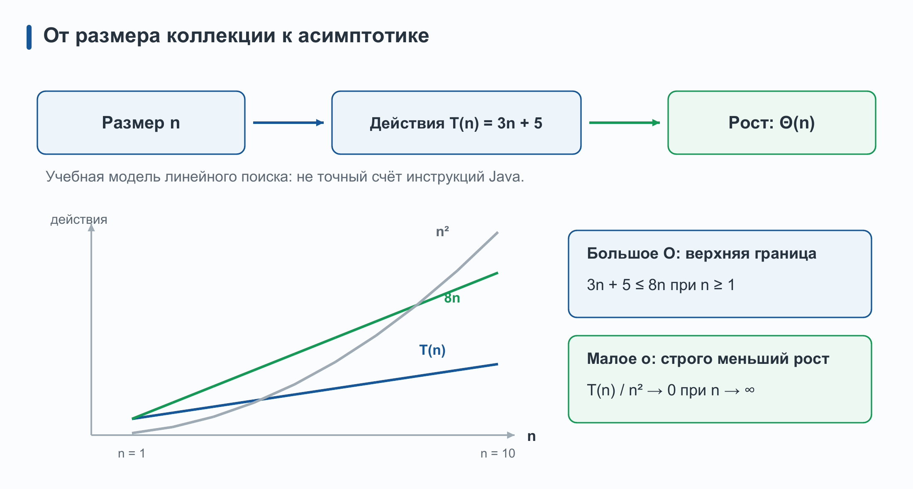

# Архив: подробная версия математического блока

### Математическое напоминание: от функции к алгоритму

В матанализе мы сравнивали функции при росте аргумента. Здесь аргумент — размер коллекции `n`, а функция `T(n)` — **число элементарных действий** операции. Например, поиск элемента в массиве в худшем случае проверяет все `n` ячеек. Если условно считать сравнение и служебные действия, можно получить модель **T(n) = 3n + 5**. Числа `3` и `5` зависят от модели подсчёта; важен рост при `n → ∞`.

| Запись | Математический смысл для положительных функций | Для `T(n) = 3n + 5` |
| --- | --- | --- |
| `T(n) ∈ O(g(n))` | Начиная с некоторого `n₀`, **T(n) ≤ C · g(n)** для постоянной `C > 0`: верхняя граница. | `T(n) ∈ O(n)`, ведь при `n ≥ 1` верно `3n + 5 ≤ 8n`. |
| `T(n) ∈ Θ(g(n))` | Функция ограничена сверху и снизу постоянными кратными `g(n)`: тот же порядок роста. | `T(n) ∈ Θ(n)`, поскольку `3n ≤ T(n) ≤ 8n` при `n ≥ 1`. |
| `T(n) ∈ o(g(n))` | Отношение **T(n) / g(n) → 0** при `n → ∞`: строго меньший порядок. | `T(n) ∈ o(n²)`, но `T(n) ∉ o(n)`. |

Знакомый из матанализа предел виден сразу: **(3n + 5) / n² = 3/n + 5/n² → 0**. Та же функция принадлежит и `O(n²)`, но это более слабая верхняя граница, чем `O(n)`.

**Мост к коллекциям:** `ArrayList.contains(e)` может просмотреть `n` элементов → в худшем случае `O(n)`; `ArrayList.get(i)` обращается к одной ячейке → `O(1)`. `O` описывает рост *выбранной функции стоимости*: худшей, ожидаемой или амортизированной. Сам символ `O` не означает «худший случай». [MIT 6.006: вводная лекция](https://ocw.mit.edu/courses/6-006-introduction-to-algorithms-spring-2020/477c78e0af2df61fa205bcc6cb613ceb_MIT6_006S20_lec1.pdf), [CMU 15-210: асимптотические обозначения](https://www.cs.cmu.edu/~15210/notes/asymptotics.pdf).
